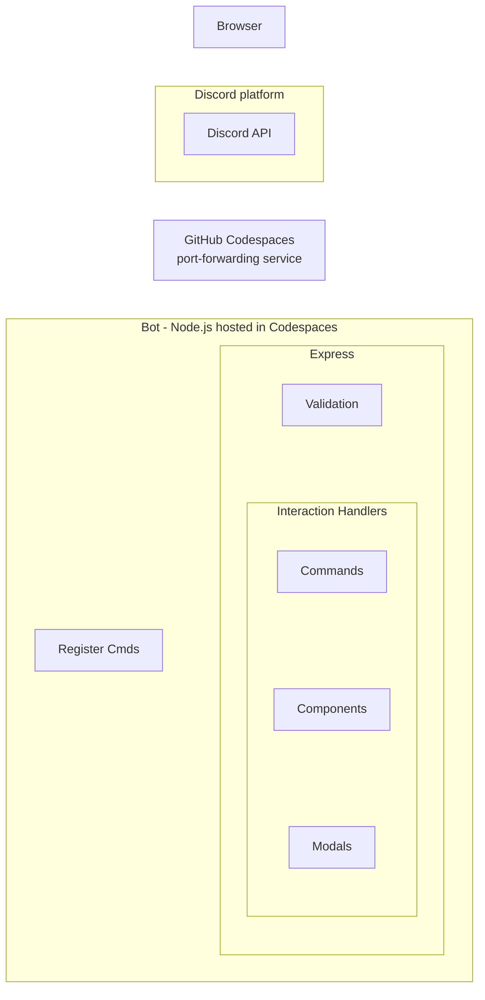
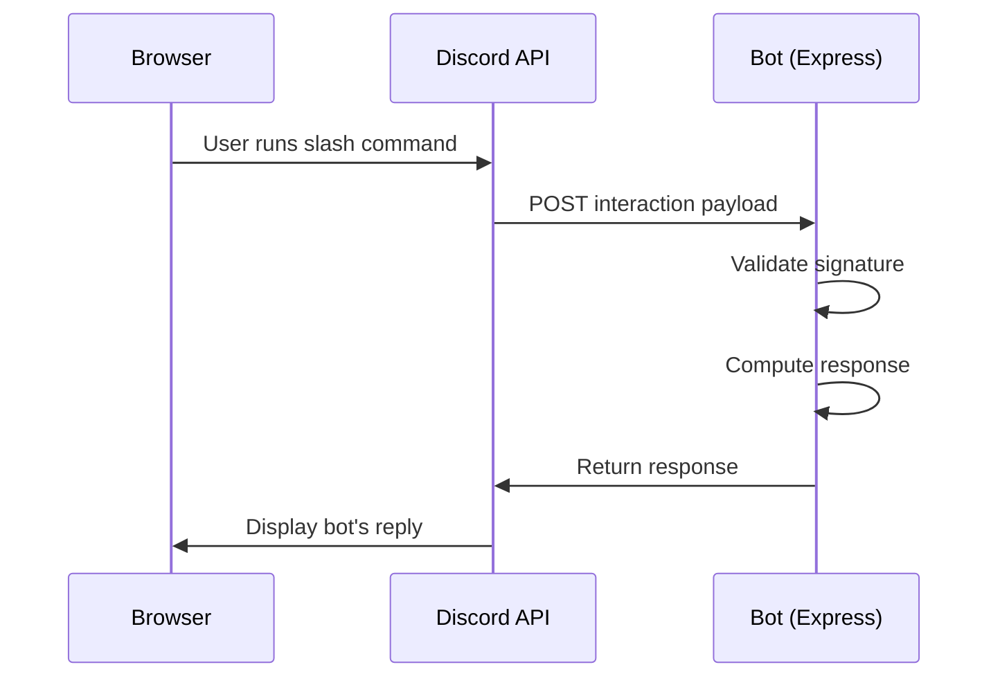

# Architecture 
This is a simple overview of how a Discord Bot works.  

## Block Diagram


Here's an explanation of the diagram:

This diagram shows how a Discord bot is built and where each piece runs, reading roughly top to bottom, to trace how a user's action turns into the bot's response. It starts with the *Browser*, representing a user interacting with Discord through their web client. That connects to the *Discord platform*, specifically the *Discord API*, which is Discord's own infrastructure that receives user actions (like typing a slash command) and needs to notify the bot about them. Since the bot doesn't have a permanent public address of its own, the request passes through the *GitHub Codespaces port-forwarding service*, which acts like a bridge, taking incoming traffic from the internet and routing it into the developer's Codespaces environment where the bot's code is actually running.  

Inside that environment is the *Bot* box, which contains everything the Node.js application does. *Register Cmds* is a one-time or occasional setup step where the bot tells Discord which slash commands it supports, separate from the ongoing request-handling flow. The bulk of the work happens inside `Express`, the web server framework, which first performs *Validation* using the `discord-interactions` package to confirm that incoming requests genuinely came from Discord and haven't been tampered with. Once validated, the request moves into the *Interaction Handlers*, a group of three specialized handlers: *Commands*, *Components*, and *Modals*. Each handler is responsible for a different type of Discord interaction (slash commands, button/menu clicks, and form submissions respectively). The handlers dispatch the work to code that contains the actual logic that decides how the bot should respond.  

## Sequence Diagram

Here is a simple visual of a request/response cycle.  

This sequence diagram provides architectural insight in a different way. Instead of providing a modular/component perspective layed out as boxes, it instead focuses on the system level communications. It illustrates what, when and where messages get passed. There are three **participants**: the `Browser`, which represents the person using Discord; the `Discord API`, which is Discord's own platform/backend; and the `Bot`, which is your `Express` server running in `Codespaces`.  

Reading from top to bottom, the diagram traces a single request through time. First, the Browser sends a slash command, which goes to the Discord API. Discord then forwards that interaction as an HTTP POST request to your Bot. The Bot performs an internal step, validating the signature on the incoming request using the discord-interactions package, to make sure the payload really came from Discord and not from an impersonator. Once validated, the Bot determines the response, and it sends that response back to the Discord API, which finally relays that response to the Browser so the user can see it. The solid arrows represent each message being sent, and the vertical order in which they appear tells you the sequence of events, which is the main thing a sequence diagram is meant to communicate: not the structure of the system, but the timeline of a specific interaction.

Here's the part that trips people up: your HTTP response isn't just "success/fail" and it certainly isn't the full HTML with JavaScript to implement the interactions on the user's browser. Instead, it's a structured JSON object made up of a **response type** and **data**. The user never sees this JSON directly. The JSON is effectively a set of instructions telling Discord's client *what to display and how*. Discord reads that object and does all the rendering on the user's screen.

Note that the sequence diagram does not follow all of the conventions of UML. For example, Activation Bars are not indicated for the actors; asynchronous vs synchronous messages are not indicated; return message line is not dashed; the reflective lines do not truly represent messages. 

## Architecture Analysis: Monolithic vs. Modular

Here we discuss the differences between `orig` and `modular-architecture`.   
Are the differences considered "architectural" or "design" in nature?   
Is modular better? Why?

### Overview of the Two Approaches

**Original (`orig/`)**: Monolithic architecture where all interaction handling (commands, buttons, modals, select menus) is centralized in a single `app.js` file (11.7 KB).

**Modular (`modular-architecture/`)**: Separated into:
- **Core handlers**: `app.js`, `command-handler.js`, `component-handler.js`, `modal-handler.js`
- **Command modules**: Each command in `commands/` directory contains all related logic

## Architectural vs. Design Distinction

These differences are **ARCHITECTURAL** in nature, not merely design decisions.

**Why?** Architecture addresses *system structure and organization*, while design focuses on implementation details within a chosen architecture. Here:

- **Monolithic** = single responsibility container (one app.js handles everything)
- **Modular** = separation of concerns across multiple modules with clear boundaries

This is a fundamental shift in how the system is organized at the module level, which is the definition of architectural change.

## Key Differences

### 1. **Code Organization & Structure**

**ORIG (Monolithic):**
```
app.js (11.7 KB)
  ├── All commands (test, test-btn, test-modal, challenge)
  ├── All button handlers
  ├── All modal handlers
  ├── All select menu handlers
  └── In-memory game state (activeGames object)
```

**MODULAR (Separated):**
```
app.js (core router)
command-handler.js (dispatcher)
component-handler.js (dispatcher)
modal-handler.js (dispatcher)
commands/
  ├── test.js (command + handler)
  ├── test-button.js (command + handler)
  ├── test-modal.js (command + handler)
  ├── test-select.js (command + handler)
  └── challenge.js (command + handler + game state)
```

Consider this argument:

> I'm looking at two different file organizations for a Discord Bot (two different architectures). One is more "monolithic" where everything goes into very few files, virtually everything is in app.js.  The modular approach has many files where each command handler is put into its own file. I'm doing a Cohesion & Coupling review. It would seem that the large, monolithic file would have low coupling because it is one giant "thing." How can there be high coupling with other "things"? 

The argument has some instincts that are correct, and we need to drill into understand this better. The confusion comes from what we count as a "thing." Coupling and cohesion are always measured relative to a chosen unit, so the first step in a review is to name the unit.

**The unit problem**

If the unit is the *file*, the monolith looks great on coupling: one file, so no inter-file dependencies. But that's an artifact of the unit you picked. A single file can't be coupled to itself in any meaningful sense, so the metric stops telling you anything. It's like claiming a city has no traffic problems because you measured it as one building.

If the unit is the *responsibility* (a command, the event router, the database access, the config), the monolith's problems appear. Those responsibilities still exist and still depend on each other. The file boundary just stopped making those dependencies visible.  

We typically examine coupling at the level of: classes, modules, packages, components, and functions.  

**What coupling looks like inside a monolith**

Coupling is about how much one piece of code depends on the internals of another. In a big `app.js` you typically see:

- **Shared mutable state.** A `cooldowns` map, a `queue` array, or a database handle at module scope that five commands read and write. This is the Discord-bot version of global coupling: change how `cooldowns` is structured and every command that touches it may break.
- **Shared helper functions with hidden assumptions.** `/ban` and `/kick` both call `logModAction()`, which quietly relies on a variable defined 800 lines up.
- **Control coupling in the dispatcher.** One giant `if/else` or `switch` on `interaction.commandName` that knows about every command. Adding a command means editing that central block, so the dispatcher is coupled to every command.
- **Accidental coupling through scope.** Any function can reach any variable. Nothing prevents `/play` from using a variable that `/help` also sets, and nobody is forced to declare that dependency.

So the monolith's coupling is real but *implicit*: it's there, but nothing in the structure documents or limits it.

**Cohesion in the same comparison**

- **Monolith:** low cohesion at the file level (music, moderation, config, and event wiring all mixed together, so the file has many reasons to change). Individual functions may still be cohesive.
- **Modular:** high cohesion per file (`ban.js` is about banning), and the file name tells you what's inside.

**What the modular version changes**

Modularity doesn't remove dependencies; it makes them *explicit and narrow*. If `ban.js` needs the logger, it has to `require('../utils/logger')`, and that line is the coupling, visible and greppable. A command file typically exposes a small interface (`data` and `execute(interaction)`), so the loader depends only on that contract, not on each command's internals. That's the low-coupling pattern: depend on an interface, not an implementation.

You can still build a badly coupled modular bot, though. If every command file imports a shared global `client` and mutates a shared `state.js`, you've reproduced the monolith's coupling across files. File count alone doesn't determine quality.

**A way to explain it to students**

A few angles that tend to work:

1. **The "change test."** Ask: "If I change how cooldowns work, how many places must I edit, and how do I find them?" In the monolith, you search a 3,000-line file. In the modular version, ideally you edit one module, or the compiler/loader/grep shows you the import sites.
2. **The kitchen analogy.** A monolith is one counter where every cook shares every tool and ingredient; nothing stops two cooks from interfering, and nobody can say who depends on whom. Modular is separate stations with a pass-through window; the window is the interface.
3. **Make them draw it.** Have students sketch boxes for each responsibility in the monolith and draw arrows for every shared variable or function call. Then draw the boundary lines of the modular version around those same boxes. The arrows crossing a boundary are the coupling that became visible.
4. **Key phrase:** *"Modularity doesn't reduce dependencies, it makes them explicit and limits who can create them."*

**A good review question set**

- What is the unit of analysis, and why?
- What shared state exists, and who can write to it?
- What does adding a new command require touching?
- Could one command be tested without loading the others?

On that last one, the monolith usually fails (you often can't import a command without starting the bot), while a well-factored `execute(interaction)` function can be unit-tested with a fake interaction.

If it's useful, I can sketch a small before/after example, say a `/ban` command in both styles, showing the hidden coupling in the monolith and the explicit imports in the modular version, which you could drop straight into a lecture.

### 2. **Coupling: ORIG vs. MODULAR**

**ORIG (High Coupling):**
- **Intra-file coupling**: All commands, handlers, and logic are tightly bound in one file
- **Import chain**: `app.js` depends on nothing; nothing depends on it
- **Global state**: `activeGames` object accessible to all handlers
- **Hard to test individually**: Can't test one command without the entire app.js

**Metrics**: All 4 commands are coupled through `app.js` - if one command changes, the entire file is touched.

**MODULAR (Low Coupling):**
- **Separation by concern**: Each command is independent; `app.js` only knows about dispatcher logic
- **Import chain**: 
  - `app.js` → `command-handler.js` → imports only what's needed
  - `command-handler.js` → imports individual commands
  - Each command module is self-contained
- **Isolated state**: Each command manages its own state (e.g., `challenge.js` has its own `activeGames`)
- **Easy to test**: Can test `challenge.js` independently without loading other commands

**Metrics**: Commands are loosely coupled through registry pattern; adding/removing commands doesn't affect the dispatcher.

### 3. **Cohesion: ORIG vs. MODULAR**

**Cohesion** measures how related the code within a module is (higher is better).

**ORIG (Low Cohesion):**
- `app.js` contains 4 different command handlers (test, test-btn, test-modal, challenge) all in the same file
- The file mixes:
  - Discord API response formatting
  - Game state management
  - Modal handling
  - Button handling
  - Select menu handling
  - HTTP routing
- **Consequence**: A developer reading one command must understand the entire file context to avoid side effects

**MODULAR (High Cohesion):**
- Each command file contains only related functionality
- Example: `commands/test-button.js` has the `/test-btn` command definition, the button ID constant, and the button click handler—everything related to that feature
- `commands/challenge.js` has the `/challenge` command, all rock-paper-scissors game logic, state management, and both button and select handlers
- **Consequence**: Reading one command file doesn't require understanding other commands

## Merge Conflicts: A Critical Advantage

### ORIG (Monolithic) - High Conflict Risk

**Real scenario**: Dev A wants to add a new `/roll-dice` command. Dev B is fixing a bug in the `/challenge` command's game logic.

- **Dev A** edits `orig/app.js` to add the new command
- **Dev B** edits `orig/app.js` to fix the game state structure

**Result**: **Merge conflict** in `orig/app.js` even though the changes are logically independent. Git sees both developers editing the same file and can't auto-merge. Someone must manually resolve the conflict, review the merge, and test it.

**If they have 6 developers and each adds one command**, all 6 edit the same file, creating a bottleneck.

### MODULAR - Conflict Prevention

**Same scenario**, modular style:

- **Dev A** creates `commands/roll-dice.js` (new file)
- **Dev B** edits `commands/challenge.js` (different file)

**Result**: **No merge conflict**. They edited different files. Git auto-merges instantly. The only change touching both is a single line in `command-handler.js` to register the new command.

**If they have 6 developers and each adds one command**, each creates their own `commands/new-command-name.js`, and merging is instant with zero conflicts.

**Why this matters**:
- Developers can work in parallel without blocking each other
- Merge conflicts become rare, reducing team friction
- Code review is focused on features, not conflict resolution
- Faster iteration cycles for teams

## Code Isolation & Reduced Confusion

### ORIG (High Context Required)

Reading the `/challenge` handler in `orig/app.js` requires understanding:
- Command handler (the initial `/challenge` interaction)
- Button handler (when a user accepts the challenge)
- Select handler (when the responding user picks their move)
- State definition (where `activeGames` is created)
- Message manipulation logic (how endpoints are built)

A developer must jump between scattered locations throughout the file, constantly returning to where state is defined. The context is fragmented.

**Real risks from this code**:
- The state object format must match between the command handler (where it's created), button handler (where it's read), and select handler (where it's deleted)—if someone changes the format in one place, others break silently
- Delete operations could fail to clean up state if an exception occurs, causing memory leaks
- Identical endpoint-building logic repeats in multiple places, and any change must be applied everywhere

### MODULAR (Contained Context)

Reading `commands/challenge.js` contains:
- Command definition at the top
- Game state management helpers (createGame, getGame, deleteGame)
- Game logic (RPSChoices rules)
- Command handler
- Component handlers (button and select)

**All in one file**. A developer:
- Opens one file
- Reads top-to-bottom
- Sees exactly how a game starts, is tracked, and is resolved
- Knows where state is managed and how it's used

**Result**: 
- Fewer cognitive load mistakes
- Easier to spot bugs (all related code is together)
- Easier to maintain (one mental model)

## Side Effects & Bug Prevention

### ORIG Risks

1. **Global state pollution**: `activeGames` is readable and writable by all handlers
   - Command handler creates entries, button handler assumes they exist, select handler deletes them
   - If someone adds a new handler and doesn't realize `activeGames` exists, they could accidentally overwrite a game in progress

2. **Hidden dependencies**: The button and select handlers depend on `activeGames` being populated correctly by the command handler, but this dependency isn't declared anywhere. It's just convention.

3. **Format brittleness**: All handlers must know the exact structure of `activeGames` entries. Change the format in one place and silent failures occur elsewhere.

### MODULAR Safety

1. **Encapsulated state**: `activeGames` is private to `commands/challenge.js`. Other commands can't access or interfere with it.

2. **Explicit interface**: `commands/challenge.js` exports only what's needed: `handleCommand()`, `handleComponent()`, and ID prefixes. Everything else is hidden.

3. **No accidental interference**: Each command file has its own namespace. `commands/test-button.js` can't accidentally collide with state in `commands/challenge.js`.


## Cohesion & Coupling Summary Table

| Metric | ORIG (Monolithic) | MODULAR (Separated) | Better? |
|--------|-------------------|-------------------|---------|
| **Cohesion** | Low (~40%) | High (~90%) | MODULAR ✓ |
| **Coupling** | High (all features in one file) | Low (independent modules) | MODULAR ✓ |
| **Lines per concern** | 200+ lines | 50-100 lines per command | MODULAR ✓ |
| **Merge conflicts** | Frequent (all in one file) | Rare (separate files) | MODULAR ✓ |
| **Context required to understand** | Entire file (~300 lines) | Single command file (~50-100 lines) | MODULAR ✓ |
| **State management clarity** | Implicit (global `activeGames`) | Explicit (local to module) | MODULAR ✓ |
| **Testability** | Hard (must load entire app.js) | Easy (test individual command file) | MODULAR ✓ |


## Is Modular Better?

### **YES, absolutely.** Here's why:

#### 1. **Scalability**
- **ORIG**: Adding a 5th command (say `/new-game`) requires editing `orig/app.js`:
  ```javascript
  if (name === 'new-game') {
    // Add 50+ lines of new logic here
  }
  ```
  The file grows from 400 to 450+ lines. Each new command makes the single file larger and harder to navigate.

- **MODULAR**: Adding a 5th command means:
  - Create `commands/new-game.js` (one new file)
  - Add one line to `command-handler.js`:
    ```javascript
    import { command as newGame, handleCommand as handleNewGame } from '../commands/new-game.js';
    // ...
    [newGame.name]: handleNewGame,
    ```
  - File count goes from 8 to 9, but no existing file grows significantly

#### 2. **Developer Experience**
- **ORIG**: Two developers are working on `/test-modal` (in `orig/app.js` around lines 84-132) and `/challenge` (lines 135-185). They both edit the same file in different areas. When they try to merge their branches, Git sees conflicts because both touched the same file, even if their changes don't overlap. They must spend time resolving merge conflicts.
  
- **MODULAR**: Two developers work on `commands/test-modal.js` and `commands/challenge.js` respectively. These are different files, so no conflicts. They merge independently, in parallel.

#### 3. **Maintainability**
- **ORIG**: Fixing a bug where the rock-paper-scissors game doesn't clean up `activeGames` properly (currently handled at line 327 of `orig/app.js`) requires:
  - Finding where `activeGames` is defined (line 10)
  - Finding where it's created (line 149)
  - Finding where it's read (lines 272, 306)
  - Finding where it's deleted (line 327)
  - Understanding the entire flow across 300+ lines
  
- **MODULAR**: All rock-paper-scissors logic is in one file (`commands/challenge.js`). The `activeGames` object is defined on line 41, and all four helper functions (`createGame`, `getGame`, `deleteGame`) are on lines 42-50. A bug fix is localized to one file.

#### 4. **Correctness**
- **ORIG**: All commands share the global namespace of `orig/app.js`. If a developer doesn't realize `/challenge` uses `activeGames`, they might accidentally use a variable with a similar name for a new command, causing a collision or overwriting game state. There's no protection against this.
  
- **MODULAR**: Each command file has its own namespace. `commands/challenge.js` has an `activeGames` object (private, not exported). `commands/test.js` has no such state. There's no way for one command to accidentally interfere with another's state.

#### 5. **Testing & Debugging**
- **ORIG**: To test the `/challenge` command handler, you'd need to:
  - Load the entire `orig/app.js` 
  - Import Express and Discord middleware
  - Mock `getRandomEmoji()` and `DiscordRequest()` from `utils.js`
  - Provide a fake `req` object with `req.body`, `req.body.member`, etc.
  - Actually test can't easily isolate the handler—you're testing it within the full HTTP request/response flow
  
- **MODULAR**: To test the `/challenge` command handler, you:
  ```javascript
  import { handleCommand, handleComponent } from './challenge.js';
  
  const fakeReq = {
    body: {
      id: 'msg-123',
      data: { options: [{ value: 'rock' }] },
      member: { user: { id: 'user-456' } }
    }
  };
  
  const result = handleCommand(fakeReq);
  assert(result.type === InteractionResponseType.CHANNEL_MESSAGE_WITH_SOURCE);
  ```
  You can unit-test `handleCommand()` and `handleComponent()` independently, mocking only what they import (`DiscordRequest`, `getRandomEmoji`)

#### 6. **Feature Independence**
- **ORIG**: The `/challenge` command is baked into `orig/app.js`. To reuse it in another Discord bot, you'd need to copy lines 10 (state), 135-185 (command), 251-300 (button handler), 301-352 (select handler), plus understand all the imports and dependencies. It's not clean.
  
- **MODULAR**: To reuse the `/challenge` command in another bot project, you simply copy `commands/challenge.js` and import it. The module is self-contained and explicitly lists its dependencies (`DiscordRequest`, `getRandomEmoji`). You can drop it into another project immediately.

## Trade-offs (What Modular Loses)

1. **Simplicity for trivial projects**: A single command bot doesn't benefit from modularity
2. **Import overhead**: Slightly more file I/O at startup (negligible for modern systems)
3. **Initial setup complexity**: Requires discipline to maintain separation

**Verdict**: These are negligible compared to the architectural benefits.

## Conclusion

The differences are **ARCHITECTURAL**: both approaches solve the same problem (handling Discord interactions) using fundamentally different system organization strategies.

**Modular is significantly better** because:

1. **Low coupling**: Commands don't interfere with each other
2. **High cohesion**: Each command is self-contained
3. **Reduced merge conflicts**: Multiple developers can work in parallel
4. **Smaller cognitive load**: Developers understand less code to make changes
5. **Fewer bugs**: Isolation prevents accidental side effects
6. **Better scalability**: Adding features doesn't require editing existing files

The monolithic approach works fine for a small, single-developer prototype, but the modular approach is the correct choice for any project that will grow or be maintained by multiple people.
