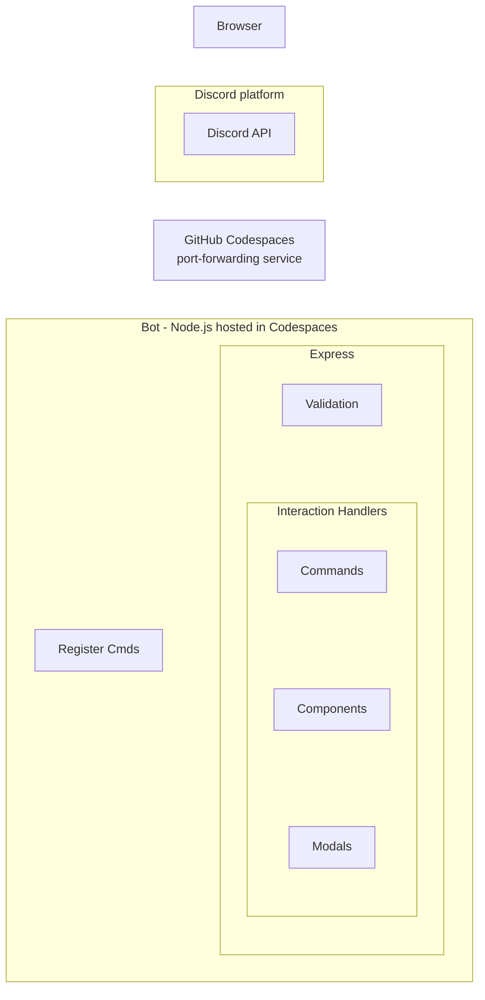
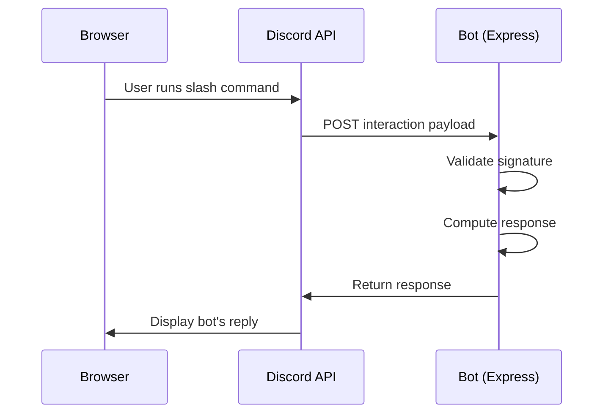
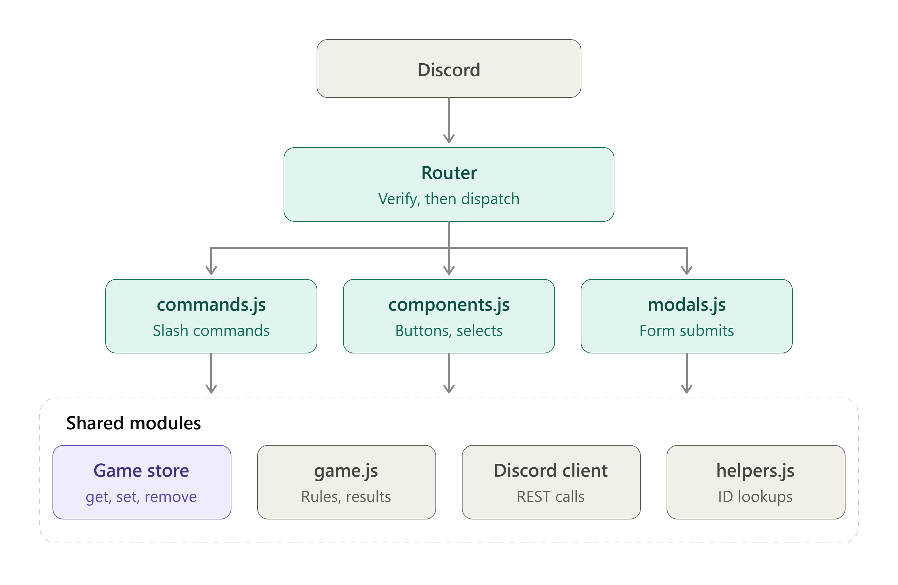
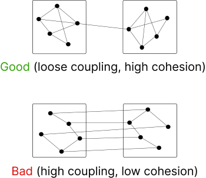
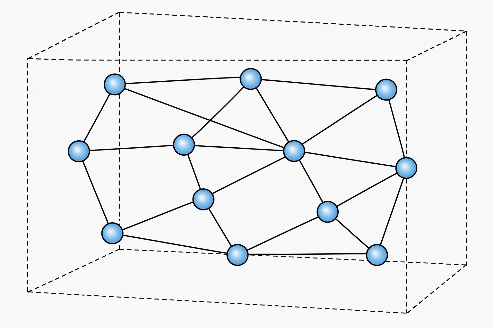

# Architecture 
This is a simple overview of how a Discord Bot works.  

## Block Diagram

Here's an explanation of the diagram:

This diagram shows how a Discord bot is built and where each piece runs, reading roughly top to bottom, to trace how a user's action turns into the bot's response. It starts with the *Browser*, representing a user interacting with Discord through their web client. That connects to the *Discord platform*, specifically the *Discord API*, which is Discord's own infrastructure that receives user actions (like typing a slash command) and needs to notify the bot about them. Since the bot doesn't have a permanent public address of its own, the request passes through the *GitHub Codespaces port-forwarding service*, which acts like a bridge, taking incoming traffic from the internet and routing it into the developer's Codespaces environment where the bot's code is actually running.  

Inside that environment is the *Bot* box, which contains everything the Node.js application does. *Register Cmds* is a one-time or occasional setup step where the bot tells Discord which slash commands it supports, separate from the ongoing request-handling flow. The bulk of the work happens inside `Express`, the web server framework, which first performs *Validation* using the `discord-interactions` package to confirm that incoming requests genuinely came from Discord and haven't been tampered with. Once validated, the request moves into the *Interaction Handlers*, a group of three specialized handlers: *Commands*, *Components*, and *Modals*. Each handler is responsible for a different type of Discord interaction (slash commands, button/menu clicks, and form submissions respectively). The handlers dispatch the work to code that contains the actual logic that decides how the bot should respond.  

## Sequence Diagram

Here is a simple visual of a request/response cycle.  

This sequence diagram provides architectural insight in a different way. Instead of providing a modular/component perspective layed out as boxes, it instead focuses on the system level communications. It illustrates what, when, and where messages get passed. There are three **participants**: the `Browser`, which represents the person using Discord; the `Discord API`, which is Discord's own platform/backend; and the `Bot`, which is your `Express` server running in `Codespaces`.  

Reading from top to bottom, the diagram traces a single request through time. First, the Browser sends a slash command, which goes to the Discord API. Discord then forwards that interaction as an HTTP POST request to your Bot. The Bot performs an internal step, validating the signature on the incoming request using the discord-interactions package, to make sure the payload really came from Discord and not from an impersonator. Once validated, the Bot determines the response, and it sends that response back to the Discord API, which finally relays that response to the Browser so the user can see it. The solid arrows represent each message being sent, and the vertical order in which they appear tells you the sequence of events, which is the main thing a sequence diagram is meant to communicate: not the structure of the system, but the timeline of a specific interaction.

Here's the part that trips people up: your HTTP response isn't just "success/fail" and it certainly isn't the full HTML with JavaScript to implement the interactions on the user's browser. Instead, it's a structured JSON object made up of a **response type** and **data**. The user never sees this JSON directly. The JSON is effectively a set of instructions telling Discord's client *what to display and how*. Discord reads that object and does all the rendering on the user's screen.

Note that the sequence diagram does not follow all of the conventions of UML. For example, Activation Bars are not indicated for the actors; asynchronous vs synchronous messages are not indicated; return message line is not dashed; the reflective lines do not truly represent messages. 

## Component Architecture Diagram 
  

Requests arrive from Discord at a single entry point, the router. Its only job is to verify that the request is genuine and decide what kind of interaction it is: a slash command, a button or select-menu click, or a modal form submission. It does no real work itself and simply hands each request to the module responsible for that kind of interaction, so reading the router tells you everything the bot can respond to.

Below the router are three handler modules: `commands.js`, `components.js`, and `modals.js`. Each one owns one category of behavior and nothing else. When a handler needs something beyond its own logic, it reaches down into a group of shared modules, shown in the dashed box. The game store is the one place that holds game state and exposes it through a small interface (get, set, remove), so no handler touches a global variable directly. The game rules live in `game.js`, calls back to Discord go through a single Discord client, and small helpers such as looking up a user ID are written once in `helpers.js`. The arrows all point downward, from the router to handlers to shared modules, so dependencies flow in one direction and no module needs to know about the ones above it. A change to one concern, such as swapping the store for a database, stays inside one box. 

# Architecture Analysis
Herein we consider the differences between `orig` ("monolithic") and `modular-architecture` in the following ways:  
* Cohesion and Coupling  
* Cyclomatic Complexity and Cognitive Load (or Observability)  
* Side Effects and Regressions  
* Duplications and Inconsistencies  
* Tendency for Merge Conflicts  
* Testability  

Modular is significantly better because:
- **Scalability:** New commands, buttons, and modals are added as new modules and one registry entry, instead of growing a single function. The team can also grow without everyone editing the same code.
- **Developer experience:** Small, well-named units are quick to read and navigate, and developers work in parallel with fewer merge conflicts. Onboarding is easier because a newcomer can learn one module at a time.
- **Maintainability:** Each fact and responsibility has one home, so changes stay local and fixes are made once. Narrow interfaces keep a change from rippling into unrelated code.
- **Correctness:** Plain functions with injected dependencies can be unit tested directly. Small units make missing responses and inconsistent logic easier to spot, and regressions are caught close to where they are introduced. 

**Overview of the Two Approaches**  
The code provided to students has same basic features implemented using two different approaches: monolithic and modular.  

The code found in `orig/` is *"monolithic"*. All interaction handling (commands, buttons, modals, select menus) is highly centralized in a single `app.js` file.  

The code found in `modular-architecture` is *"modular"*. It is comprised of *dispatchers* and *modules*. There are two layers of dispatchers: the first dispatch layer routes the *type of interaction* (e.g. command, component, or modal) to the next dispatcher layer that sends it to a specific function/module.  

## Cohesion and Coupling
> We want **high cohesion** and **low coupling**.  

  
> **_Def_: Coupling:** Coupling is the degree of interdependence between software modules--how closely one module relies on another's internal workings, data, or behavior. It reflects how a change in one module might require a change in another.  

High coupling is bad because it tightly binds components together, making systems fragile, difficult to maintain, and resistant to change, whereas low coupling promotes modular, flexible, and maintainable software. 

Coupling is about how much one piece of code depends on the internals of another. Typically, high coupling design results in:      
- **Ripple effects**, where a change in one piece forces changes in others
- **Fragile code**, where small edits break distant parts of the system without warning
- **Difficulty testing**, since a piece cannot be exercised without dragging its dependencies along
- **Limited reuse**, because a component cannot be lifted out and used elsewhere without its neighbors
- **Slower development**, since developers must understand many parts of the system before safely changing any one of them 

In the *monolithic* Bot architecture you'll find the code is structured so that there are very few functions. The code has a large control structure (multiple stacked *ifs*) handling the `interactions` route. The code is a textbook example of [Logical Cohesion](https://thesestudies.blogspot.com/2023/10/logical-cohesion-in-software-engineering.html), where unrelated operations are grouped because they all "handle an interaction." Logical cohesion means grouping elements by a shared logical or technical theme rather than a single, clear purpose. In most software engineering contexts, functional cohesion (all elements contribute to one well‑defined task) is preferred. If you're interested, you can read up on [Cohesion Categories here](http://www.cs.iit.edu/~cs561/cs487/cohesion/Categories.html).  

Consider this argument:  
> The "monolithic" architecture has *everything* in very few files; virtually everything is in app.js. The modular approach has many files where the code for each command is put into its own file. It would seem that the large, monolithic file would have *low coupling* because it is one giant "thing."   

This argument has a more thorough response <a href="#q-and-a">Q&A section below</a>. There is little merit to this argument. The monolithic code is difficult to test, has limited reuse, and does not lend itself well to multiple developers. The design is poor. While we can argue that the "monolithic" design has coupling that is moderate and mostly hidden, there is a strong case to be made against its cohesion.  

> **_Def_: Cohesion:** Cohesion is the degree to which elements within a module belong together and work toward a single, well‑defined purpose.   

High cohesion means each module has a clear, single responsibility, making it easier to test, maintain, and reuse.  
Low cohesion can lead to "spaghetti" code where changes in one part affect unrelated parts, increasing maintenance cost and risk.  

Modularity doesn't remove dependencies; it makes them *explicit and narrow*. You can still build a badly coupled modular bot, though. If every command file imports a shared global variable and mutates a shared state, we've introduced high coupling.  

Analyzing and Understanding Cohesion/Coupling:

1. **The "change test"**: Ask yourself, "If I change how Feature X works, how many places must I edit, and how do I find them?" In a monolithic file, you search a single 3000-line file and make multiple edits sprinkled across the file. In a modular version, ideally you would edit one module with a size that is easier to digest.  
2. **The "and" test**: Describe what the function does in one sentence without "and" or "or."   
3. **The name test**: If the honest name for a function is `handleEverything`, we've got a problem. A function with a single responsibility is easy to name (e.g.handleChallenge, handleAccept, handleModalSubmit): names would be precise.  

**Review questions to ask yourself:**  
- What is the unit of analysis, and why?
- What shared state exists, and who can write to it?
- What does adding a new command require touching?
- Could one command be tested without loading the others?

### UML Component Diagram
Components are drawn as boxes, and the interfaces are shown in "ball-and-socket" (lollipop) notation. A circle (the ball) means "this component provides this interface," and a half-circle (the socket) means "this component requires it." A dashed arrow from one component to another is a dependency. 

> **UML component diagram:** Components are drawn as boxes, and the interfaces are shown in "ball-and-socket" (lollipop) notation. A circle (the ball) means "this component *provides* this interface," and a half-circle (the socket) means "this component *requires* it." A dashed arrow from one component to another is a dependency.  

**What they do well**
- They show *structural* coupling at a glance: who depends on whom, how many arrows leave or enter a box (fan-out and fan-in), and whether the dependencies form cycles.
- The provides/requires notation makes the idea of coupling *through an interface* concrete. A dependency on a small, stable interface is visibly different from a dependency on a whole module.
- They support architectural conversations, such as layering violations or a module that everything depends on.

**What they do badly**
- **They show that a dependency exists, not how strong it is.** One arrow could mean "calls one function with a string" or "reads and writes five fields of my internal state." Content, common, and stamp coupling all look identical.
- **They miss hidden coupling.** Coupling through shared global state, string conventions like the `custom_id` format, or timing and ordering assumptions is invisible unless someone draws it in deliberately.
- **They stop at the module boundary.** This is the most relevant point for your example. A diagram of the monolithic file is one box with a few arrows out to `game.js`, `utils.js`, and Discord. It would suggest low coupling, which is the exact impression you were wary of earlier. The problem lives *inside* the box, so the diagram cannot show it.
- **They are idealized.** A diagram drawn by hand shows the intended design, which may differ from the code. Diagrams generated from the code are more trustworthy but can be cluttered.

## The Monolithic Pain  
**Cohesion and Coupling**  
*Monolithic Pain:*  
> A monolithic handler has logical cohesion: unrelated operations sit together only because they all respond to the same kind of request. Its coupling is hidden rather than low, since every branch shares the same request and response objects, global variables, and implicit string conventions that silently link steps of a workflow. 

*Why modular is better*:
- Each unit has a single, clear purpose, so its name describes everything it does
- Dependencies are passed in explicitly instead of hidden in shared state
- Changing one module rarely forces changes in another
- Related logic lives together, making it easy to find and reason about

**Cyclomatic Complexity and Cognitive Load**  
*Monolithic Pain:*  
> One function holds many decision points across long chains of conditionals, early returns, and error handling. A reader must keep the whole function in mind to understand any one branch, and it is hard to spot paths that never send a response.

*Why modular is better*:
- Each function has few decision paths, so it is easy to read and verify
- A reader only needs to understand one behavior at a time
- A thin dispatcher shows everything the app supports at a glance
- Missing responses and error paths are easier to spot in small functions

**Side Effects and Regressions**  
*Monolithic Pain:*  
> Because all branches share one scope, with similarly named local variables and shared state, a change in one branch can break another without warning. Altering a data format or the structure of shared state ripples through code the author may not realize is connected. 

*Why modular is better*:
- Local scope prevents variables from accidentally colliding or being reused
- Narrow interfaces confine the impact of a change
- Shared state is owned by one module, so changes to it happen in one place
- Regressions are caught closer to where they are introduced

**Duplications and Inconsistencies**  
*Monolithic Pain:*  
> The same knowledge is repeated and applied differently in several places, such as extracting an identifier from a request or reading a configuration value, and one variant may even fail in a case the others handle. Copy-paste leftovers like redundant nested checks are another symptom. 

*Why modular is better*:
- Each fact or rule has a single home (a single source of truth)
- Bug fixes are made once and apply everywhere
- Behavior stays consistent across features
- Shared helpers reduce copy-paste errors and leftover code

**Tendency for Merge Conflicts**  
*Monolithic Pain:*  
> Every new feature edits the same long function in the same file, so developers working on unrelated features will routinely collide on the same lines. Code review is also harder because the diff lands in a huge function with little context. 

*Why modular is better*:
- Developers can work in parallel without blocking each other
- Merge conflicts become rare, reducing team friction
- Code review is focused on features, not conflict resolution
- Faster iteration cycles for teams

**Testability**  
*Monolithic Pain:*  
> The logic can only be reached through the web framework's request and response objects, real environment configuration, and live external calls, so even a simple test requires heavy mocking. Core behavior cannot be tested apart from the transport layer. 

*Why modular is better*:
- Plain functions can be unit tested with ordinary inputs and assertions
- Dependencies can be replaced with simple fakes instead of heavy mocking
- Core behavior can be tested without the web framework or network
- Small, fast tests make failures easy to diagnose and encourage more testing

Here is a concrete example. To test the `/challenge` command handler, you'd need to:
  - Load the entire `orig/app.js`   
  - Import Express and Discord middleware  
  - Mock `getRandomEmoji()` and `DiscordRequest()` from `utils.js`  
  - Provide a fake `req` object with `req.body`, `req.body.member`, etc.  
  - Summary: In actuality, we can't easily isolate the handler. We're testing it within the full HTTP request/response flow.  

## Cyclomatic Complexity 
> **_Def_: Cyclomatic Complexity:** Cyclomatic Complexity is a quantitative measure of the number of linearly independent paths through a function or program. It is calculated by counting the number of decision points (such as if statements, loops, and logical operators) plus one. A higher cyclomatic complexity indicates more complex logic and typically correlates with increased difficulty in testing and understanding the code.  

  

## Q & A
**Are the differences considered "architectural" or "design" in nature?**   
**Short** Both. And we're splitting hairs here; it doesn't really matter.   
**Long**: The modular-architecture approach could be considered either *Architectural* or *Design*. We could say *architectural* because we set the *structure and organization* of the Discord Bot. We established the architecture of the Bot. However, we could also say *Design* because the fundamental architecture of how to get a Discored Bot to work with Discord wasn't changed. For example, we did not change the fact that Bot needs to communicate via JSON over HTTPS to the Discord Platform where Discord Applications are registered. The topology of the system is untouched; the higher level architecture established by Discord still determines the lay of the land.  

**How can there be *high coupling* with other "things" when there is only one "thing"?**   
The confusion comes from what we count as a _"thing."_ We typically examine coupling at the level of: classes, modules, packages, components, and functions. We should NOT use a *file* as our *unit of measurement* when examining Coupling. The monolith's design has high coupling, even if the coupling is implicit and hidden within the file. The coupling is present and poor.  

If we allowed the unit to be the *file*, the monolith looks great on coupling: one file, so no inter-file dependencies. But that's an *artifact of the unit*. A single file can't be coupled to itself in any meaningful sense, so the metric stops telling you anything. It's like claiming a city has no traffic problems because you put everything into one giant building.  

Lastly, the functionality (code) within the giant file doesn't have a meaningful relationship; the vast functionality doesn't semantically belong together. This means that there is low *cohesion*.  