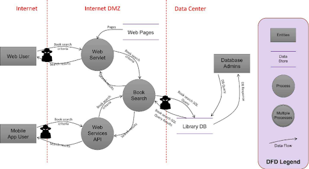
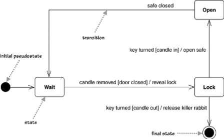
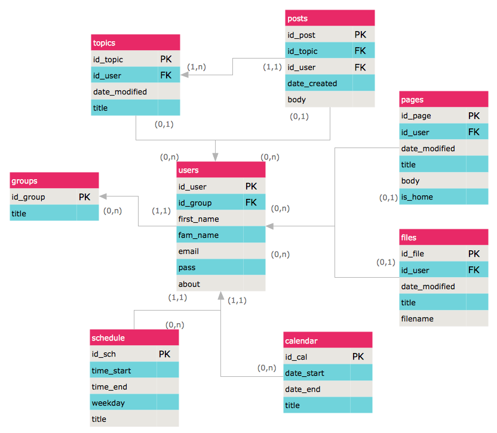
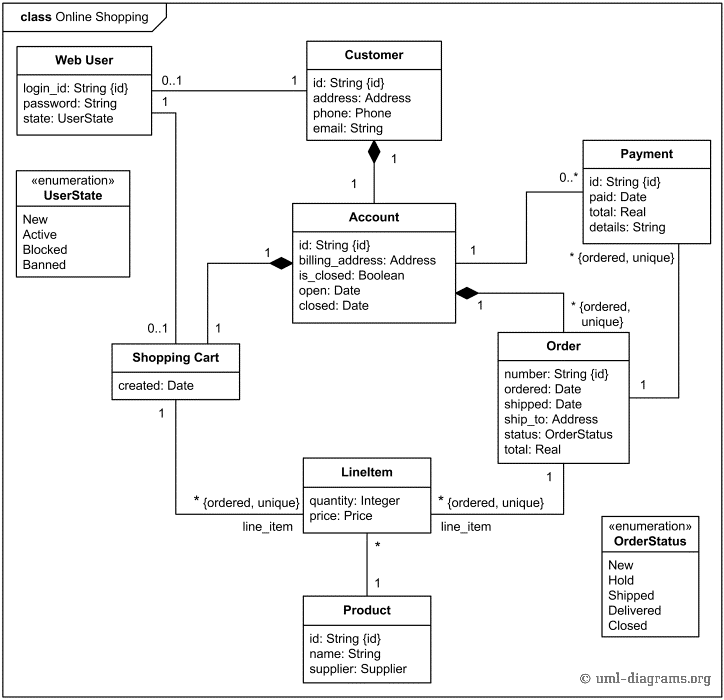
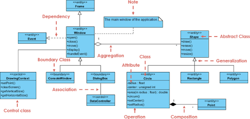
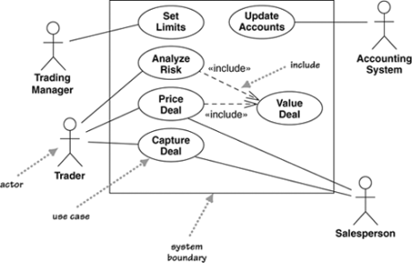
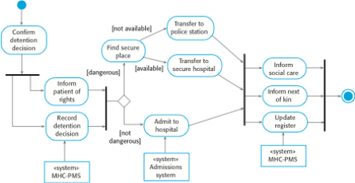
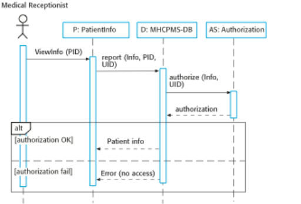

# Period 3: Reading Reflections

## Summary
This section's overall theme is **Project Management** as we examine techniques to gather requirements, create an architecture, brainstorm features, how to estimate costs, and how to test.  We look at using UML to draw architecture--to remove software's invisibility characteristic.  

### Slide Decks

* <a href="#3.3">3.3 System Models</a>  
* <a href="#3.4">3.4 Brainstorming</a>
* <a href="#3.45">3.45 Estimation Techniques</a>  
* <a href="#3.x">3.x Requirements</a>   
   * <a href="#definition-of-done-dod">Definition of Done</a>
* <a href="#3.5">3.5 Project Management</a>
* <a href="#3.6">3.6 Security</a>

### Reading
Sprint #2 and our work in the Discord Bot is a part of this time period. You should know the [Q&A found here](README-task2.md#q--a).

#### 3.3 System Models

##### Overview:

* [Unified Modeling Language (UML) Diagrams \- GeeksforGeeks](https://www.geeksforgeeks.org/system-design/unified-modeling-language-uml-introduction/)   
* [Agile Models Distilled: Potential Artifacts for Agile Modeling](https://agilemodeling.com/artifacts.htm)   
* Examples: [Examples of UML diagrams \- use case, class, component, package, activity, sequence diagrams, etc.](https://www.uml-diagrams.org/index-examples.html)   
* Sommerville: Chapter 5: [Software Engineering, 10th GLOBAL Edition](https://dn790001.ca.archive.org/0/items/bme-vik-konyvek/Software%20Engineering%20-%20Ian%20Sommerville.pdf) 


##### Data Flow Diagram

* [What is DFD (Data Flow Diagram) \- GeeksforGeeks](https://www.geeksforgeeks.org/software-engineering/what-is-dfddata-flow-diagram/)   
* [Data Flow Diagram (DFD)s: An Agile Introduction](https://agilemodeling.com/artifacts/dataFlowDiagram.htm) 

##### Sequence Diagram

* [Sequence Diagram Tutorial \- Complete Guide with Examples | Creately](https://creately.com/guides/sequence-diagram-tutorial/)   
* [UML Sequence Diagrams: An Agile Introduction](https://agilemodeling.com/artifacts/sequenceDiagram.htm)    
* [UML sequence diagrams overview of graphical notation \- lifeline, message, execution specification, interaction use, etc.](https://www.uml-diagrams.org/sequence-diagrams.html) 

##### Class Diagram

* [UML Class Diagrams: An Agile Introduction](https://agilemodeling.com/artifacts/classDiagram.htm)   
* [UML Class Diagram \- GeeksforGeeks](https://www.geeksforgeeks.org/system-design/unified-modeling-language-uml-class-diagrams/)   
* [UML Class Diagram Tutorial](https://www.visual-paradigm.com/guide/uml-unified-modeling-language/uml-class-diagram-tutorial/) 

##### Activity Diagram 

* [https\://www\.geeksforgeeks.org/system-design/unified-modeling-language-uml-activity-diagrams/](https://www.geeksforgeeks.org/system-design/unified-modeling-language-uml-activity-diagrams/)   
* [Activity Diagram \- Activity Diagram Symbols, Examples, and More](https://www.smartdraw.com/activity-diagram/) 

##### Use Case Diagram

* [Use Case Diagram \- Unified Modeling Language (UML) \- GeeksforGeeks](https://www.geeksforgeeks.org/system-design/use-case-diagram/)   
* [UML Use Case Diagrams: An Agile Introduction](https://agilemodeling.com/artifacts/useCaseDiagram.htm)   
* [Use case diagram \- Wikipedia](https://en.wikipedia.org/wiki/Use_case_diagram) 

##### State Diagram

* [State Machine Diagrams | Unified Modeling Language (UML) \- GeeksforGeeks](https://www.geeksforgeeks.org/system-design/unified-modeling-language-uml-state-diagrams/)   
* [UML State Machine Diagrams: An Agile Introduction](https://agilemodeling.com/artifacts/stateMachineDiagram.htm) 

##### Network Diagram

* [Network Diagrams: An Agile Introduction](https://agilemodeling.com/artifacts/networkDiagram.htm)   
* [Computer network diagram \- Wikipedia](https://en.wikipedia.org/wiki/Computer_network_diagram) 

##### Entity Relationship Diagram

* [ER Diagram Symbols: Complete Guide to Notations & Meanings](https://www.we-notes.com/component-breakdown-decoding-er-diagram-symbols/)  
* [Database Star](https://www.databasestar.com/entity-relationship-diagram/)  

#### 3.4 Brainstorming & Estimation

* [Dev schedules, flying pigs, and other fantasies – I.M. Wright’s “Hard Code”](https://imwrightshardcode.com/2001/06/dev-schedules-flying-pigs-and-other-fantasies/)   
* [Project buffer overflow – I.M. Wright’s “Hard Code”](https://imwrightshardcode.com/2018/11/project-buffer-overflow/)

#### 3.5 Project Management and Testing  
* [The Mythical Man-Month. | Chapter 2](https://learning.oreilly.com/library/view/mythical-man-month-the/0201835959/ch02.xhtml)   
* [Calling the Shot | Chapter 8 | Mythical Man-Month](https://learning.oreilly.com/library/view/mythical-man-month-the/0201835959/ch08.xhtml)   
* [Hatching a Catastrophe | Chapter 14 | Mythical Man-Month](https://learning.oreilly.com/library/view/mythical-man-month-the/0201835959/ch14.xhtml) 

	**Optional**:

* [JUnit — Practical Java](https://java.mrstride.com/frameworks/junit.html)   
* [Practice: Test Guidelines — Practical Java](https://java.mrstride.com/frameworks/good_tests.html) 

<a id="3.3"></a>
## 3.3 System Modeling with UML 
These questions come from the 3.3 Slide deck.

**Why do software teams create system models?**  
Software is largely invisible, so models take the "invisible" out of it by turning ideas into graphical representations people can see and discuss. They help the team understand the problem and the system to be built, and they convey that understanding to others such as customers and developers.

**A system model usually leaves out many details of the real system. Why is this considered a strength?**  
A model is an abstract view of the system, so it deliberately omits detail. Leaving details out reduces noise and confusion and keeps attention on what is important to understand.

**What is UML?**  
UML (Unified Modeling Language) is a standardized set of diagram types, semantics, and notations for modeling systems, designed to support object-oriented analysis and design. It includes 14 diagram types, grouped into structural diagrams (such as class diagrams) and behavioral diagrams (such as use case, sequence, activity, and state machine diagrams).

**What is the main purpose of a context diagram?**  
A context diagram shows the single system of focus at the center, with the external entities and the data that cross the system boundary. Knowing the boundary tells you what you will develop and what you will depend on other systems for. It is like a high-level (Level 0) DFD.

**Describe a Data Flow Diagram (DFD)**  
A DFD models how data moves through a system between processes, data stores, and external entities, as if you were "interviewing the data." It is not a process diagram: it has no conditionals or logic and does not define an order, although order can often be inferred. DFDs can be drawn at multiple levels, from Level 0 (the context diagram) down to more detailed levels.  

It is important to denote boundaries to help identify threats. The "spy" icon is added for dramatic effect to indicate that there could be a Man-in-the-Middle attack.  

The arrows should be unidirectional and always labeled with what data flows. The circles are "processes" (modules or servers) that accept and provide data.

  
In this example, we see a Data Flow Diagram (DFD) with the term DMZ. It stands for Demilitarized Zone, and it's a key concept in network security. A DMZ is a buffer zone between an organization's internal network and the external internet. It contains systems that need to be accessible from the internet (like web servers, email servers, or DNS servers), but are isolated from the internal network to reduce security risks.

**What does a state diagram (state machine diagram) show?**

A state diagram shows the states of a system, process, or object and the events that cause it to transition from one state to another. For example, a safe might move between wait, open, and lock states. Transition labels follow the pattern: action \[condition\] / resulting action.

  

**What does an Entity-Relationship Diagram (ERD) describe?**

An ERD describes the logical structure of the data: the entities, their attributes, and the relationships between entities. It models the data itself, not classes or behavior, and the physical structure may differ to address performance and maintenance. It is widely used in database design.

  
In this example we see PK (Primary Key) and FK (Foreign Key) that indicate unique IDs that are used for definition relationships to other tables. In databases, these are typically integer values, but they can be large 128-bit GUID values as well. The numbers in the parentheses represent the type of relationship using numbers. We usually name them one-to-one, one-to-many, or many-to-many. A zero value means that no relationship is required.  

The example ERD diagram leaves a lot out and is not academically a perfect example. Stride thinks it is a pretty good real-world example.  

**How does a UML class diagram differ from an ERD?**

A class diagram models the static structure of software, including both data (attributes) and behavior (methods), and uses relationships such as association, aggregation, composition, and inheritance. An ERD models only data and its relationships, usually for database design. The two are complementary tools, not interchangeable.  

The diagrams look similar, for sure. 

**In a UML class diagram, what is the difference between composition and aggregation?**

Both are "has-a" relationships, but they differ in ownership. In composition (filled diamond) the part cannot exist independently, so if the whole is destroyed the part is destroyed too, such as a hash map and its hash table. In aggregation (open diamond) ownership is shared, so the parts live on if the whole goes away, such as students in a course section that is cancelled.

  
This is a **UML class diagram**. The label in the top-left corner, "class Online Shopping," is the diagram frame, naming the diagram type and its subject. It models the **structure** of an online shopping system: what kinds of things exist, what data each holds, and how they relate. It does not show behavior or the order of events (that is what sequence and activity diagrams are for).

Each rectangle is a **class**, drawn in compartments: 1) **Top** the class name. 2) **Middle** the attributes. 3) **Bottom** operations (methods). In this example, the bottom is omitted which is common when the focus is on data structure.

A plain line between two classes is an **association**: the two classes know about or relate to each other. The small numbers at each end are **multiplicities** (how many of one object relate to one of the other):

| Symbol | Meaning |
|---|---|
| `1` | Exactly one |
| `0..1` | Zero or one (optional) |
| `*` | Zero or more |
| `0..*` | Zero or more (written explicitly) |

There are three **filled black diamonds**, and they mean **composition**, the strongest whole-part relationship. The diamond sits at the **whole** end, and the part's lifetime depends on the whole. For example: **Customer ◆ Account:** means that an Account is owned by a Customer. If the Customer is removed, the Account goes with it. 

**Important notes:**  
- This diagram is a good contrast with the earlier ERD diagram: the **filled diamonds** here are UML composition and do not belong in an ERD.    
- Notice there are **no hollow diamonds** (aggregation) and **no arrowheads**. The lines are undirected associations, so you may wonder where "arrows" are. In class diagrams, arrows are used for navigability, inheritance (hollow triangle), and dependencies, none of which appear here.  

  
Here is an Annotated Class Diagram. 

**What is a UML Use Case diagram primarily used to show?**  
A use case diagram shows the interactions between a system and its external actors (people or other systems). Actors are drawn as stick figures outside the system boundary, and use cases (the tasks) are drawn as ovals inside it. It is typically used during requirements analysis to identify the functionality the system should offer, with relationships such as include and extend linking use cases.

  

**In a UML Activity Diagram, what do a fork and a join represent?**  
A fork splits the flow into actions that can happen in parallel, where the order does not matter. A join synchronizes those parallel actions so the flow continues only when they are done. Choices are shown separately with a decision and merge.

  
This UML activity diagram models the *flow of work* through a process: what steps happen, in what order, and where the path can split, branch, or come back together. It is read like a flowchart, following arrows from the *solid circle* (the start) to the *bullseye* (the end). The rounded rectangles are *actions*, single steps that someone or something performs. The thick black bars are *fork and join* nodes: a bar with one arrow in and several out splits the flow into steps that can happen in parallel (here, informing the patient and recording the decision), and a bar with several arrows in and one out is a join that waits for every incoming path to finish before continuing. The hollow *diamond* is a *decision* node, where the flow takes exactly one of several outgoing paths depending on a condition written in square brackets, called a `guard` (such as "[dangerous]" and "[not dangerous]"). Small boxes tagged with a stereotype like «system», attached to an action by a line, show which system supports that step, a way of adding who or what is involved without cluttering the main flow.

What an activity diagram tells us is the *logic and sequence of a process*, which makes it well suited to explaining business procedures, workflows, or the steps behind a single use case. It makes three things visible that are hard to see in prose: which steps can run at the same time, which steps are *alternatives* depending on a condition, and which steps must all complete before the process can move on. It focuses on *behavior over time*, not on structure (that is the job of a class diagram) or on messages between specific objects (that is the job of a sequence diagram). A reader should be able to look at the diagram and understand the whole story of the process, including its unusual paths, without needing to know anything about how it would be coded.  

**Describe how to read a UML Sequence Diagram?**  
Read it from top to bottom, because time moves downward, not left to right. Each participant has a vertical lifeline, activation bars show when it is actively working, and horizontal arrows show messages in order, with solid arrows for requests and dashed arrows for replies. Closed arrowheads indicate synchronous calls and open arrowheads asynchronous ones. When there is more than one possible messaging sequence, the diagram makes use of an `alt` block.  
  

**Why do Software Engineers often use several different types of models for the same system?**  
Different models are complementary: each captures a different kind of information, such as data flow, data structure, interactions, or behavior. Together they give a more complete picture than any single model could. Which approach a given model belongs to matters less than knowing that many models exist.

**If a sequence diagram for a trip to Hawaii includes the arrows "Fly to Hawaii" and "Drive to hotel," why is this a poor sequence diagram?**  
It mixes messages with physical activities and state changes. A sequence diagram is about communication between participants, such as "Give ID" or "Provide reservation information," and should answer who communicates with whom, what is exchanged, and in what order. Activities like flying or driving belong in an activity diagram, a use case scenario, or a written narrative.

**How do classical structured analysis and object-oriented analysis differ in their view of a system?**  
Classical structured analysis emphasizes that process and data are separate, and uses process-oriented models such as DFDs, ERDs, and state transition diagrams. Object-oriented analysis unifies data and behavior around objects, using UML diagrams such as class, use case, sequence, and activity diagrams. The boundaries between the approaches are blurry, so the key point is knowing the focus of each.

<a id="3.4"></a>

## 3.4 Brainstorming  

### Brainstorming Rules

1. **Define the Goal Clearly**  
   Ensure everyone understands the specific product goal you are trying to achieve.

2. **Encourage Wild Ideas**  
   No idea is too crazy. Encourage participants to think outside the box.

3. **Build on Others’ Ideas**  
   Use “Yes, and…” instead of “No, but…” to build on each other’s ideas.

4. **Defer Judgment**  
   Avoid criticizing or evaluating ideas during the brainstorming session. Focus on quantity over quality at this stage.

5. **Stay Focused on the Topic**  
   Keep the discussion centered on the product goal. Use a facilitator to guide the conversation if necessary.

6. **One Conversation at a Time**  
   Ensure that only one person speaks at a time to maintain clarity and respect.

7. **Be Visual**  
   Use diagrams, sketches, or sticky notes to visualize ideas. This can help in understanding and building on concepts.

8. **Set a Time Limit**  
   Limit the brainstorming session to a specific time frame to keep the energy high and focused.

9. **Encourage Participation from Everyone**  
   Make sure all participants have an opportunity to contribute. Sometimes the quietest voices have the most innovative ideas.

10. **Document All Ideas**  
    Record all ideas generated during the session. You can evaluate and prioritize them later.

11. **Have Fun**  
    Create a positive and enjoyable atmosphere. Fun can spark creativity and lead to better ideas.

<a id="3.45"></a>

## 3.45 Estimation Techniques  

### Article: Project Buffer Overflow (by IM Wright)  
To estimate, use historical completion rate.  
Accurate estimation requires using historical data, trusting calculated timelines, and applying only necessary buffers. Avoid unrealistic promises and overcommitment by focusing on scope management and maintaining professional, data-driven planning. This approach builds trust with customers and management while preventing burnout and disappointment.

1. Commit to deliverables when you can ensure the scope and timeframe are realistic and achievable  
2. Use historical data and avoid wishful thinking  
3. Break features into small tasks and use a team’s velocity to estimate completion date  
4. Avoid “magical” buffers  
5. Three kinds of buffers:  
   1. Buffer of work: to keep everyone productive at all times. Good to have.  
   2. Time buffer: added to time estimates. Bad because it avoids addressing the real problem–bad estimates.  
   3. Last-mile buffer: accounts for variations and end-of-game delays. Historical data shows that it takes time to account for last-minute “hijinks” that invariably pop up.

### Article: Flying Pigs (by IM Wright) 
Development scheduling succeeds when it prioritizes risk management over rigid deadlines, focuses on critical features first, and avoids the myth of precise time estimations. Teams and customers benefit most when the process emphasizes quality and coherence over arbitrary dates.

1. Dev estimations are flawed.  
2. Effective project planning costs are T-shirt sized  
3. Projects schedule high priority features first so that cuts can be made to low-pri items later  
4. **Scheduling is less about hitting feature deadlines and more about managing risks.**  
5. A risk-managed approach leads to delivering high-quality, essential features that truly satisfy customer needs.  
6. Customer-centric focus fosters better team collaboration, morale, and decision-making

**1\. Why does Wright argue that detailed feature-by-feature schedule estimates are largely a fantasy, and what experience does he use to support that claim?**  
Wright argues that software development contains **too much uncertainty** for precise feature-level estimates to be reliable. He bases this view **on practical experience**, claiming that beyond very small or highly repetitive tasks, developers often cannot accurately predict how long implementation will take.

**2\. What is the purpose of the "hard/medium/easy" estimation scale, and how does it differ from assigning specific dates to individual features?**  
The purpose of the scale is to provide a rough assessment of effort while **acknowledging uncertainty.** Unlike specific feature dates, it helps teams reason about capacity and risk without creating a false sense of precision.

**3\. Wright claims that development scheduling is primarily about risk management rather than time management. What risks does he believe a schedule should help a team manage?**  
Wright believes schedules should help teams manage the **risk that we won't deliver the right features with the right quality at the right time.** His approach focuses on protecting critical functionality rather than attempting to predict exact completion dates for every feature.

**4\. Do you agree with Wright's statement that "the only dates that count are project dates" and not feature dates? In what situations might feature-level dates still be valuable?**  
Milestones are generally more important because they keep attention focused on **overall product success** rather than individual tasks. However, feature-level dates can still be useful when *coordinating dependencies* among teams or tracking particularly high-risk work.

**5\. According to Wright, how can feature deadlines actually make a project more likely to fail, even though deadlines are intended to improve accountability?**  
Wright argues that developers who feel pressure to hit feature deadlines may hide problems instead of communicating risks early. This reduces management's ability to respond to emerging issues and can lead to lower quality, increased stress, and larger schedule slips later.

**6\. If you were managing a modern Agile team using tools such as GitHub and Scrum boards, which parts of Wright's approach would you adopt and which parts would you reject? Why?**  
One might put emphasis on prioritizing must-have features, communicating risk early, and avoiding false precision in estimates. One could reject the idea that feature dates are largely irrelevant because Scrum boards, sprint goals, and backlog planning benefit from shorter-term commitments that help teams coordinate work while still accommodating uncertainty.

### Article: Project Buffer Overflow (by IM Wright)

**1\. Wright argues that most traditional estimation buffers are unnecessary. What are the three types of buffers he describes, and why does he believe only one of them is actually needed?**  
1\) a work buffer that keeps engineers supplied with ready-to-start tasks; 2\) an estimation buffer that compensates for poor estimates, and; 3\) a final delivery buffer that accounts for last-minute variation and surprises. He argues that if estimates are based on historical completion data, only the final delivery buffer is necessary because the other two exist primarily to compensate for poor planning or inaccurate estimation practices.

**2\. How does Wright propose using historical team data to estimate future work, and what assumptions must be true for this approach to succeed?**  
He recommends calculating a team's historical task completion rate and then estimating a feature by dividing its expected number of tasks by that rate. This approach assumes that work is consistently broken into reasonably similar-sized tasks, that the team has reliable historical data, and that future work resembles the work used to establish the completion rate.

**3\. Wright repeatedly tells readers to "believe the estimate." Why does he think teams and managers struggle to trust estimates that are based on historical data?**  
He believes people often distrust data-driven estimates because they want to believe they can work faster, work harder, or somehow achieve a better outcome than their historical performance suggests. He argues that this optimism leads managers and engineers to second-guess valid estimates instead of accepting what the data indicates about likely completion dates.  

**4\. Wright argues that if you need to shorten a schedule, you should reduce scope rather than assume people can work faster. Do you agree? Why or why not?**  
Yes, most would agree. Reducing scope is a predictable way to meet a deadline because it directly decreases the amount of work that must be completed, while assuming developers can work significantly faster is often unrealistic. Although productivity can sometimes improve through better tools or processes, those gains are usually smaller and less reliable than delivering a smaller set of features. Focusing on the highest-priority requirements also helps preserve quality and reduce risk.  

**5\. Wright claims that working weekends and applying pressure do not significantly accelerate delivery and may even reduce quality. How consistent is this claim with your own experiences or observations of software projects?**  
This claim is very consistent with industry observations. Short periods of extra effort can occasionally help a team meet a milestone, but extended overtime can sometimes lead to more bugs, technical debt, and burnout. Developers who are tired tend to make more mistakes, which increases the amount of rework needed later. As a result, any time saved upfront is often lost during testing, debugging, and maintenance.  

**6\. If you were managing a modern Agile team using tools such as GitHub and Scrum boards, which parts of Wright's estimation approach would you adopt and which parts would you reject? Why?**  
Parts worth adopting are:  
Wright's emphasis on using historical team performance data, breaking large features into smaller tasks, and making commitments based on evidence rather than optimism. Those practices align well with Agile principles and help create more reliable forecasts.   

Parts worth reconsideration are:  
Relying solely on counting tasks could be suspect in a Scrum team because tasks can vary greatly in complexity. In Kanban, Wright encourages teams to have each task/card be about the same amount of work. But one could easily run a team where task can have distinct costs where one can combine task breakdowns with metrics such as velocity, cycle time, and throughput.   

In summary, this answer keeps his data-driven mindset while using modern Agile forecasting techniques to improve accuracy.

### Slide Deck Content
**What is the _Cone of Uncertainty_, and how should it change the way early estimates are presented?**  
The cone of uncertainty says that early estimates are inherently wide because so much is still unknown, and that they narrow as the project progresses. Early on, an estimate is best shared as a range, not as a single precise number.

**What are optimism bias and the planning fallacy, and why do tasks run late far more often than early?**  
Optimism bias and the planning fallacy are the tendencies to assume things will go better than they usually do and to underestimate how long work will take. Task durations also have a skewed distribution: there is little room to finish much earlier than expected but no limit on how much later a task can run.

**What is anchoring, and how can a team reduce its effect?**   
Anchoring happens when the first number spoken, or the loudest voice, dominates the group's estimate. A team can reduce it by having everyone estimate privately and reveal together, as in planning poker.

**How do Hofstadter's Law and Parkinson's Law differ?**  
Hofstadter's Law says it always takes longer than you expect, even when you account for Hofstadter's Law. Parkinson's Law says work expands to fill the time available, regardless of the actual effort required, so too much slack is also a problem. 

> **Hofstadter's law**:  
> * It always takes longer than you expect, even when you take into account Hofstadter's law.  

> **Parkinson's Law**:   
> * Work expands so as to fill the time available for its completion.  
> * The core idea is that if you allocate more time than necessary for a task, the task will grow in complexity or take longer to complete, often due to procrastination, overthinking, or unnecessary perfectionism.

**What does Brooks's Law say, and why does it hold?**  
Brooks's Law says that adding people to a late project makes it later. New people must be brought up to speed and add communication overhead, which slows the people already doing the work.

**What strategies can counter Parkinson's Law?**  
Timeboxing sets a fixed, short block of time for a task, and self-imposed shorter deadlines compress an honest estimate to about 50–70%. Other strategies are the [Pomodoro Technique](https://www.todoist.com/productivity-methods/pomodoro-technique) (25-minute focus intervals with 5-minute breaks), defining "done" before starting, and visual timelines such as [Gantt charts](https://project-management.com/what-is-a-gantt-chart/) or progress boards.

**Why is it harmful to treat estimates as commitments?**  
When estimates are commitments, teams protect themselves by padding them (sandbagging) and may work unsustainable hours, leading to burnout. An estimate is a forecast made with incomplete knowledge, not a promise.

**How does three-point estimation work? Calculate it for O = 3, M = 6, and P = 15.**  
You give an optimistic (O), most likely (M), and pessimistic (P) value and combine them as (O + 4M + P) / 6, which weights the most likely value most heavily. Here it is (3 + 24 + 15) / 6 = 42 / 6 = 7.

**What are the main steps in a round of Planning Poker?**  
The product owner presents a story and answers questions, then each person privately picks a card from a Fibonacci-style scale (1, 2, 3, 5, 8, 13, 21) and everyone reveals at once. The highest and lowest voters explain their reasoning, and the team re-votes until estimates converge, then records the result and moves on.

**What are the "reference story" and the "parking lot" in planning poker?**  
The *reference story* is a small, familiar story agreed on as a baseline (for example, "this is a 2") that other stories are compared with. The *parking lot* is where a story goes if the team cannot converge after multiple attempts, since it probably needs more detail or should be split. Let's face it, Planning Poker isn't magical; if people cannot come to an agreement then more time is needed. Don't force it.

**How are story points and T-shirt sizing similar, and how do they differ?**  
Both are relative sizing methods that avoid committing to exact hours or dates. T-shirt sizing (small, medium, large) is quick and coarse, so it is used for roadmapping, while story points use a numeric scale for finer relative sizing, often with planning poker.

**Why is adding a buffer a poor technique, and what is a better alternative?**  
A buffer tends to be bigger for inexperienced estimators, so it hides poor estimates instead of improving them. Throughput and velocity-based forecasting is better because it uses the team's historical data, though it requires a bit of process.

**What is the 80-20 rule in estimation, and how can negotiation help?**  
The [80-20 rule](https://vkestimatingsolutions.com/2016/05/20/8020-rule-applied-to-estimating-effort/) says that 80% of the work takes 20% of the time, while the last 20% of the work takes 80% of the time. This is also known as the [Pareto Principle](https://en.wikipedia.org/wiki/Pareto_principle).  

> One way to mitigate expensive requests is to *negotiate*. For example, you can offer to deliver only 80% of the ask for some fraction of the full, original cost.  

**How do sampling and the tracer bullet approach help with estimation?**  
Sampling means measuring how long a portion of the work takes and then scaling that up to the whole. A tracer bullet builds a thin end-to-end slice first, which flushes out hidden gotchas and complexity before the full estimate is trusted.

<a id="3.x"></a>
## 3.x Requirements

**Functional Requirement:**

* Describe functionality from the **user’s perspective**.  
* Focus on **what the system should do** (functional behavior).

**Non-Functional Requirements (NFRs)**:

* Describe **quality attributes** (performance, security, scalability, usability).  
* Often apply to the **system as a whole**, not a single user interaction.  
* Example: *The system must respond within 2 seconds under peak load*.

The user story leans towards defining functional requirements, but this  

**User Stories can be used to describe Functional, Non-Functional, and Design Constraints**

1. *Non-Functional*: As a business owner, I want my product to scale to 20k users.  
2. *Non-Functional*: As a user, I want the app to be responsive (no lag greater than 500ms).  
3. *Design Constraint:* As a system architect, I want the application to use a Redis cache for shared data so that distributed servers can access frequently used information efficiently.  
4. *Functional*: As a customer, I want to reset my password through email verification so that I can regain access to my account if I forget my password.  
5. *Non-Functional*: As a system architect, I want distributed servers that can access frequently used information efficiently". This Non-Functional requirement is poor because the word *efficiently* should be replaced with a metric.  

**What is a Design Constraint?**

A Design Constraint is neither a functional nor a non-functional requirement. It specifies an implementation decision. The system's users do not care whether Redis is used; they care about the resulting performance. This statement constrains the design. 

**Comparisons:**  
* **Constraint:** "The system shall use Redis." (implementation choice)  
* **Functional requirement:** "As a developer, I want an API for storing and retrieving cached data."  
* **Non-functional requirement:** "The API shall return responses within 100 ms for 95% of requests."

**Why is feature creep considered a common cause of project failure?**  
Uncontrolled additions and changes to requirements throughout development lead to budget and schedule overruns, unstable design and code, and poor overall quality and satisfaction. It is what happens when changes are not managed, which is why change control matters.

**What three things does a feasibility study check about a proposed system?**  
It checks whether the system contributes to organizational objectives, whether it can be engineered with current technology and within budget, and whether it can be integrated with the other systems in use. Its purpose is to decide whether the system is worthwhile before major investment.

**How do the questions "Can we build it?" and "Should we build it?" differ?**  
"Can we build it?" is the technical feasibility question: is current technology enough, and can the system be integrated? "Should we build it?" is the financial and organizational question: is it worth the cost, and does it support the organization's goals? A project can pass one and fail the other, for example a system that is buildable but not worth the money.

**How can a feasibility study be done when the detailed requirements have not been gathered yet?**  
It does not need a full specification, only a high-level picture of the project's objectives from sponsors and stakeholders. From that, the team makes rough estimates of cost, resources, technical risk, and timeline, often by comparing with past projects or industry standards. This prevents investing in a project that later proves unfeasible or misaligned with business needs.

**What is the difference between user requirements and system requirements, and which type of requirement are they?**  
User requirements have a customer focus, while system requirements have a developer focus (more detailed, but not necessarily technical). Both are functional requirements, which describe the functionality or services the system is expected to provide and are what cause a customer to want the product.

**What are some key characteristics of functional requirements**  
The *acceptance criteria* are specific to a feature. They need to be precise, complete, and consistent. This can be achieved in many ways, including using the following techniques:  
* Use User Stories to explain context, goal, and benefit of what should be done    
* Explicitly state what is **NOT** going to get done  
* Provide a list of Test Scenarios  
* Have a Definition of Done, a checklist that all features must satisfy before being understood as complete (e.g. Code reviewed by the Subject Matter Expert, merged into the integration branch, Integration Tests pass, etc).  

The risks of failing are obvious: Ambiguous requirements can be interpreted in different ways, incomplete ones leave out services users need, and inconsistent ones contradict each other. 

**What does the aircraft reliability example show about non-functional requirements?**  
If a functional requirement is not met, users can usually find a work-around, but for an unreliable aircraft system the only "work-arounds" are to pray, scream, or panic. It shows that non-functional requirements such as reliability, response time, and security can be more critical than functional ones, and that failing them can make customers stop using a product.

**How would you rewrite the requirement "The system should be fast" so that it is a good non-functional requirement?**  
Add a metric, for example: "The system shall return search results within two seconds under normal operating conditions." With a metric the team can objectively test whether the requirement is met, which is difficult with a vague word like "fast." The "ilities" are tied to non-functional requirements that are measured.

**How could the vague requirement "Secure system" be restated as a functional requirement, and why would you do so?**  
It could become "The system shall verify a user ID and password before allowing access." Restating a non-functional requirement as a concrete behavior makes it quantifiable and easier to test, which helps quality assurance. A useful question is: what features can we create to make sure we meet the non-functional requirement?

**In what ways do constraints differ from ordinary requirements?**  
Requirements describe what capabilities or qualities the system must have, while constraints limit the design or the project itself, such as "written in C++" or "operational by April 15th." Constraints can be product or business oriented, lean toward "how" rather than "what," and may be changed by management. They can also be viewed as a kind of non-functional requirement.

**Name several common categories of constraints and give an example of each.**  
Budget (actual dollars, not people), schedules (dates), technology, development (the number of developers with specific expertise), operations (data center location, people, services), team and organization (location, size), and software process (which life cycle is used). For example, a deadline of April 15th is a schedule constraint, and having only two developers who know a required language is a development constraint.

**What qualities make a requirement statement good?**  
It should be easy to read, free of ambiguity (with terminology defined), verifiable, and specific, using dates rather than "ASAP." It should also be organized for its audience and numbered so it can be traced through validation and verification.

**What should a good scenario include?**  
A scenario is a real-life example of how the system can be used. It should describe the starting situation, who (the actor) does what, the normal flow of events, what can go wrong, other concurrent activities, and the state when the scenario finishes.

**How is a requirement different from a specification, and why number them?**  
A requirement is the high-level statement (the book's user requirement), while the specification provides the detailed version. Numbering both lets you trace each one through the software process, including validation and verification.

**What is requirements management, and what should a team plan for?**  
It is the process of managing changing requirements during requirements engineering and development, which is needed because requirements are inevitably incomplete and inconsistent and new ones emerge. The team should plan how requirements are identified, how changes are analyzed (the change management process), how much traceability information is kept, and what CASE tool support is needed.

### Definition of Done (DoD)

> **Key characteristics:** The `Definition of Done` applies universally to ALL work (unlike Acceptance Criteria which varies per story), evolves as team capabilities mature, and is non-negotiable - work not meeting DoD cannot be released. It typically includes code review, automated testing with specific coverage thresholds, documentation updates, security scans, and deployment verification. (Credit to: [Teaching Agile](https://teachingagile.com/scrum/psm-1/scrum-implementation/definition-of-done)) 

The `Definition of Done (DoD)` is a team-wide quality standard that applies to every item (reviewed, tested, merged, and so on). The description we provide in a Work Item on the Kanban board--the details that define when a specific work item is complete--is usually called `Acceptance Criteria`. It is common for folks, even professionals in the industry, to mix up these two terms.  

#### What Does "Done" Mean? 
When you write a User Story, you are *starting* a conversation, not *finishing* a contract. For example, "As a player, I want to challenge the bot to Rock-Paper-Scissors" tells us a little bit of *what* the feature is, and a little bit about *why* the work matters. But the all required details just can't fit into the User Story.  

The Work Item needs a short *specification*: if you handed the story to any teammate, they should be able to build it and know for certain whether they had finished, without asking you a single question. The specification should not contain any judgement calls or ambiguity. The feature is precisely and objectively described. Nothing is left to the imagination.  

**Acceptance Criteria Techniques**  
Scrum favors writing only what is necessary, so get to the point. And it's okay to be informal.  

Here are common techniques for providing acceptance criteria:  
1. Write a short list of **test scenarios** that must pass. These test scenarios can be the *acceptance criteria*. Alternatively, these test scenarios can be written up in a separate work item for separate tracking.   
2. State what is **not** required. Saying *"no leaderboard needed"* protects you from potential disconnects and misunderstandings.  
3. Avoid repeating team-wide understandings and DoD activities. For example, "merging through a pull request." Mention process only when it is unusual for this feature and not included in the DoD. 
4. Write small follow-up stories that add detail one piece at a time, structuring them in an outline format. This technique is commonly used with a larger User Story that is too big to be tracked as a single work item. The larger User Stories might be at the Epic or Feature level.    

#### Validation vs Verification
**Acceptance Criteria** tells us when we've met the customer's expectations (for this feature). It tells us when we're done developing this feature's functionality. It is similar to Validation: *did we build the right feature?*  

The **Definition of Done** tells us when we've met the team's *standards* of development. It is tells us when we've completed all the required steps during development. It is similar to Verification: *did we build this feature right?*  

While the above definitions sound nice and clean, things are not so cut-and-dry. Definition of Done items are *mostly* verification (code reviewed, tests pass, standards followed), but some DoD items touch validation too, such as *"demoed to the Product Owner."* Likewise, checking acceptance criteria involves verifying the feature behaves as specified.  

> *How important is it to know the minutiae here?* Not very. The important thing is that we learn how to document what is needed and only what is needed to be effective and efficient.  

#### Acceptance Criteria examples
**Poor**  
- "The slash command works and is pushed to main."  
- "Done when the bot is finished."

These are vague, non-specific, untestable, and/or restate what is already assumed in the team's `Definition of Done`. These examples do not have specifics or metrics and can be subjective. 

Sometimes the work is hard to define without exorbitant text. Then it can be handy, and somewhat acceptable, to be overly informal and subjective. For example, one might reasonably say, *"The diagram is clear and professional."* See below for better phrasing.  

**Good Example #1**  
Consider the task to create a Sequence Diagram.  

*User Story:* As a developer, I want a Sequence Diagram of the Rock-Paper-Scissors game-logic.  

*Acceptance Criteria:*  
- A hand-drawn sequence diagram shows the participants User, Discord, command handler, and game-logic module for one full round of Rock-Paper-Scissors, from the slash command to the result message.
- It includes one alternative path (a tie or an invalid choice) shown with an `alt` frame.  
- Every label can be read in a photo without zooming in.
- Two paragraphs explain the order of events and what design choice the diagram reveals.  

*Not required:* digital tools, other bot commands, or network-failure handling.

*Validation:* When a different person reads only the diagram and text, they can correctly answer "What happens on a tie?" without asking the author.

**Good example #2**  
Consider the task to create the slash command: `/stride`  

*User Story*: As a Discord user, I want a slash command `/stride` that responds with a creative quip.  

*Acceptance Criteria:*  
- When a user runs `/stride`, the bot posts the text reply within 2 seconds.  
   - The user will see the response: `One small step for a man, one giant Stride for mankind.`  
- The command is dispatched by the modular command handler code.  
- The command is registered the same way as the existing commands.

*Not required:* arguments, a database, or permission checks.

### Test Scenarios

#### What is a test scenario?

A test scenario is a short description of one situation your feature must handle, written so that someone else can try it and say "pass" or "fail." It describes *what* to check, not every keystroke needed to check it. Think of it as one sentence in a conversation with your tester: "Make sure the bot handles a tie."

A good scenario does three things:  

1. **It is checkable.** Another person can run it and reach the same verdict you would. "The bot responds correctly" is not checkable. "The bot announces a tie when both players choose the same move" is.
2. **It covers something that matters.** Each scenario protects one meaningful behavior, including the unhappy paths (bad input, missing data), not just the case where everything goes right.
3. **It is short.** If you need a paragraph, you are probably describing two scenarios, or you are writing a test case (see below).

#### How specific should it be?

A scenario sits at a middle level: specific enough that the outcome is unambiguous, general enough that it doesn't dictate exactly how to perform it.

- **Too vague:** "Test the Rock-Paper-Scissors command."
- **About right:** "A player submits an invalid move, and the bot replies with the list of valid moves."
- **Too detailed for a scenario:** "Open Discord, click the message box, type /rps, press Tab, type 'lizard', press Enter, then wait three seconds and read the reply."

The last one is a script. It belongs in a **test case**, not a scenario.

#### Techniques for Writing Test Scenarios
**Technique**: Use the `Given/When/Then` format.  

The simplest format is three short parts:

- **Given** the starting situation
- **When** something happens
- **Then** what you should observe

**Example Test Scenarios:**        
   - GIVEN an open poll with the options "Pizza" and "Tacos," WHEN a user selects "Pizza," THEN the bot confirms the vote was recorded and the poll results show Pizza with one vote. 
   - GIVEN an open poll where a user has already voted, WHEN that same user votes again, THEN the bot tells them they have already voted and the vote count does not change.  
   - GIVEN a poll that has been closed by its creator, WHEN a user tries to vote, THEN the bot replies that the poll is closed and the results do not change.  
   - GIVEN an open poll, WHEN a user who did not create it tries to close it, THEN the bot refuses and the poll stays open.  
   - GIVEN a user without moderator permissions, WHEN they run the mute command on another member, THEN the bot refuses and the target member is not muted.  
   - GIVEN a moderator mutes a member for 5 minutes, WHEN the 5 minutes elapse, THEN the member can send messages again.  
   - GIVEN the bot is online and a player has started a game, WHEN the player submits "lizard," THEN the bot replies with a message listing rock, paper, and scissors.

**Notes on above examples:**
* Not every scenario needs all three parts.  A one-line rule can be fine when the behavior is super simple. For example:  "The reply is under 2,000 characters".  
* The Test Scenarios do not need to have **GIVEN/WHEN/THEN** in all caps. This was done for emphasis in our examples.  

**Technique:** Find and write only the scenarios worth writing.  

You can't test everything, so use these questions to choose:

- **The normal path:** What happens when everything goes right?
- **The variations:** What are the different valid outcomes (win, lose, tie)?
- **The bad input:** What if the user types nothing, something misspelled, or something unexpected?
- **The boundaries:** What is the smallest, largest, or last allowed value?
- **The out-of-scope line:** What are we deliberately *not* testing? Writing this down keeps you from being graded on work nobody asked for.

Aim for a handful of scenarios per feature, not dozens.

### Test Scenarios vs Test Cases

A **test scenario** says *what situation* to check. A **test case** says *exactly how*: the specific steps, the exact input, and the exact expected result. One scenario can lead to several test cases.

| | Test Scenario | Test Case |
|---|---|---|
| Question it answers | What should we check? | How exactly do we check it? |
| Level of detail | High level | Low level |
| Example | Invalid move gets a helpful reply | Type `/rps` with input "lizard." Expect: "Please choose rock, paper, or scissors." |

For the invalid-move scenario, you might write three test cases:  
1. input "lizard,"  
2. input "" (empty),  
3. input "ROCK" in capital letters. 

> You only write test cases when the details matter, such as when an edge case is easy to get wrong or when you are automating the check.

### Test Scenario Reflection

A relatively short scenario description can work even though they are high level for two reasons.

First, your teammates share your context. They know the project, the bot, and the existing commands, so you don't need to explain how to run the bot or where the command is registered. You only need to state the part that is unique to this feature.

Second, the scenario fixes the *outcome*, not the path. Two testers may choose slightly different inputs, but if the scenario says "the bot replies with the list of valid moves," both will correctly reach the same pass or fail verdict. The freedom in *how* to test is fine as long as there is no freedom in *what counts as success*.

Before you hand your scenarios to a teammate, ask yourself:

- Could someone else run this without asking me a question?
- Would two people agree on pass or fail?
- Does it avoid words like "works," "correct," or "properly" without saying what that means?

If you answer yes to all three, your scenario is ready.

Consider these:  
**"It works."** FAIL! This is not a test scenario. It names no situation, and two people will disagree about what it means.

**"When a user submits an invalid choice, the bot replies by telling the user to pick a valid choice."** PASS! This is a high-level test scenario. It works as long as the tester knows which choices are valid and invalid. Because it leaves room for interpretation, it relies on the tester's judgment and shared understanding of the project.

**"When a user submits an invalid choice, the bot replies with 'The choice was invalid. Please pick from one of these valid options: rock, paper, scissors.'"** PASS! This is effectively a test case because of the exact text. A tester can objectively say the feature does or does not do what is expected. Use this level of detail when the exact wording is the requirement, not by default.

<a id="3.5"></a>
## 3.5 Project Management

### The Mythical Man-Month (Chapter 2)

Brooks argues that software projects are frequently underestimated because people are overly optimistic about how smoothly work will proceed. He explains that while project cost may be measured in man-months, project progress cannot be accelerated simply by adding people because of communication and training overhead. People underestimate testing and integration work. He states Brook's Law: adding manpower to a late software project often makes it even later.

* People incorrectly assume that *effort* and *elapsed time* are interchangeable.  
* Adding more people into a development process does not increase the speed of development. In fact, it can sometimes slow things down because of added communication requirements, coordination, and ramp-up time.  
* Task Division Challenges: Plenty of tasks cannot be broken down, distributed, and done in parallel. For example, 9 women cannot give birth to a baby in 1 month.  
* People ought to use historical productivity data to improve estimates  
* The myth is: more people equals fast work.  
* Brooks’ Law: *“Adding manpower to a late software project makes it later.”*  
* Software projects often suffer from optimism about deadlines and underestimate unforeseen complexities. Brooks emphasizes the importance of contingency planning and realistic scheduling.  
* The Second-System Effect: Brooks warns that engineers often over-design their second system, incorporating excessive features learned from their first project, leading to bloated, delayed, and overly complex systems.

**A somewhat controversial or extreme claim**  
The most famous and controversial claim from the chapter is:

> "Adding manpower to a late software project makes it later."

This claim, which later became known as **Brooks's Law**, runs counter to the common-sense belief that adding more workers should always help a project finish sooner. Brooks argues that onboarding and communication costs can outweigh any productivity gains from the additional personnel.

**Arguable given today's software engineering**  
Software projects today are often organized around smaller autonomous teams and modular architectures that can make parallel development more practical. Nevertheless, Brooks's core observation about onboarding costs, communication overhead, and the limits of dividing knowledge-intensive work remains widely accepted.

#### Brooks: Mythical Man-Month Q \& A

**Brooks argues that two things are not interchangeable. What are those? Why does that impact estimation?**  
Brooks argues that **effort and elapsed time** are not interchangeable. Here, effort means the "Total Cost" in person-months needed to complete everything. Elapsed time = Total Cost / People.  A project requiring 12 person-months of effort cannot necessarily be completed by 12 people in one month because many tasks must be performed sequentially and because additional people create communication and coordination overhead, which makes schedule estimation more complex. There is also no direct relationship between Effort and Productivity, especially when we consider the broad range of people and their experience. It can be a huge effort to implement a relatively small feature; it may take a long time to discover a fix to a relatively small bug.

**Is Brooks's Law still 100% valid today? When is it more or less applicable?**   
Brooks's Law is not 100% valid in every situation today, but its core insight remains relevant. It is most applicable when new developers must be trained, when work is highly interconnected, or when the project is already in trouble, and it is less applicable when work can be divided into largely independent tasks and new team members can contribute immediately.

**Is optimism still the primary source of inaccurate estimates? What might also contribute to inaccuracies?**  
Optimism continues to be a major source of estimation error because people tend to assume that work will proceed without significant obstacles. Other contributors include changing requirements, technical debt, hidden complexity, incomplete requirements, organizational dependencies, staffing changes, and pressure from stakeholders to commit to aggressive schedules.

**Brooks argues that testing is the most mis-scheduled part of programming. How much proportional time does Brooks schedule for Coding vs Testing?**  
Brooks argues that testing is often severely underestimated and suggests that ***coding typically accounts for about one-sixth*** of the schedule, while component testing and system testing together account for roughly half, while planning accounts for the remaining third. His recommendation was intended to counter the common assumption that coding is the majority of the work.

**What modern Testing technique do we use to help address the amount of time spent testing after development is done?**  
Today, Testing and Development are done hand-in-hand, together with the deliverable. Furthermore, automated testing work can be done even before coding. This modern approach, automated testing, is coupled with Continuous Integration and Continuous Delivery (CI/CD) pipelines. By running unit tests, integration tests, and regression tests continuously throughout development, teams can discover defects earlier and reduce the large testing phase that traditionally occurred after coding was completed.

**If a project is behind schedule today, what actions should be tried before adding more developers, and how do those actions compare with Brooks's recommendations?**  
Before adding developers, teams should identify bottlenecks, reduce scope, remove low value features, automate repetitive work, improve requirements clarity, and focus effort on the highest risk tasks. For heaven's sake, one could even consider moving the delivery date. Teams will always try to improve efficiency, but this doesn't always mean "working smarter." Often times the best way to improving efficiency is to automate\! People's level of efficiency is limited.

### Books: Calling the Shots (Chapter 8)

#### Summary  
Brooks examines the challenge of software estimation and argues that reliable schedules must be based on empirical data rather than optimism or intuition. He reviews productivity data from several software projects and observes that programming effort grows nonlinearly with system size, that *coding itself represents only a fraction of total project work*, and that communication overhead and organizational complexity significantly affect productivity. Brooks's central message is that meaningful estimation requires collecting and **analyzing historical project** data because software development is too complex to estimate accurately through judgment alone. 

**A somewhat controversial or extreme claim**  
One of the more striking claims in the chapter is that productivity can vary dramatically based on communication demands and project structure, with some studies showing programmers producing several times more output in low-communication environments than in highly coordinated projects. The implication that communication overhead can overwhelm the benefits of additional personnel can feel extreme to those who assume larger teams naturally produce software faster.

**What might be different or arguably wrong today?**  
Brooks relies heavily on lines of code and instruction counts as measures of software size, whereas contemporary teams often think in terms of features, business value, user outcomes, or flow metrics. Many organizations today are skeptical of long-range software estimates and instead favor iterative forecasting approaches used in Agile and Lean development.

#### Questions to Discuss

**What is Brooks's argument for how software estimation should be done?**  
Brooks argues that software estimation should be based on empirical evidence from past projects rather than intuition, optimism, or management pressure. He believes organizations should collect productivity and schedule data so future estimates can be grounded in actual experience rather than wishful thinking.  

**If coding represents only a fraction of total project effort, why do managers and stakeholders often focus so heavily on coding productivity?**  
Coding is the most visible part of software development, making it easier to observe and measure than activities such as requirements analysis, design, testing, integration, communication, and project coordination. As a result, stakeholders often overestimate the impact of coding speed and underestimate the effort consumed by all the supporting work required to deliver a successful system.  

**How relevant are Brooks's observations about communication overhead now that teams have tools such as GitHub, Microsoft Teams, and modern collaboration platforms?**  
Brooks's observations remain highly relevant because communication challenges arise from coordination and dependencies, not just the mechanics of exchanging information. Modern tools make communication faster and more transparent, but large teams still face significant overhead when aligning decisions, integrating work, and managing shared understanding.  

**Does the widespread use of Agile methodologies make software estimation easier, or does it simply change the way uncertainty is managed?**  
Agile generally does not eliminate estimation difficulty; instead, it changes how uncertainty is handled by emphasizing short iterations, frequent feedback, and continual replanning. Rather than attempting to predict an entire project accurately upfront, Agile teams focus on improving forecasts as new information becomes available.

### Brooks: Hatching a Catastrophe (Chapter 14)

#### Summary  
Brooks argues that major project delays rarely result from a single disaster; instead, they emerge gradually through the accumulation of many small schedule slips that are ignored or underestimated. He emphasizes the importance of defining sharp, measurable milestones because vague notions such as "almost finished" obscure real progress and conceal delays. Brooks advocates the use of critical-path and PERT-style scheduling to **make dependencies visible**, identify which delays truly matter, and prevent teams from rationalizing lost time. Just making the chart can be of more value than the chart itself. He also discusses the organizational tendency to **hide problems from management**, stressing that leaders need reliable status information without automatically intervening. He recommends disciplined tools and process to **expose early warning signs** before a project becomes *a year late* "one day at a time."

Critical Path: The longest path in a project. If it is delayed, the entire project is delayed.

PERT: the Project Evaluation and Review Technique is a valuable tool for effective project management *(or at least it used to be, but not so much today)*. It helps teams visualize the sequence of tasks, understand dependencies, and identify the critical path for timely project completion. It is a diagram showing: Tasks, Dependencies between tasks, Expected durations, and Critical paths through the project. It can look like an activity sequence diagram. 

The following PERT diagram shows that BOTH Database Design and UI Design need to be complete before Integration Testing begins. A delay in either impacts the release.
```
             ┌─> Database Design ──┐

Requirements ┤                     ├─> Integration Testing ──> Release

             └─> UI Design ────────┘
```

Brooks concludes with the claim that time dedicated to being a watchdog (an early warning system) can contribute more to overall project success than doing programming tasks. A few people dedicated to schedule visibility and coordination can prevent catastrophic project delays while a few additional programmers may add only marginal productivity. 

**What might be different or arguable today?**  
Several aspects of the chapter can be questioned from a modern software engineering perspective:

**Heavy reliance on PERT and centralized planning.**  
Brooks views detailed dependency tracking and milestone management as the primary defense against schedule slippage. Modern Agile, Scrum, and Lean approaches often favor shorter iterations, continuous delivery, and empirical measurement over large upfront network schedules.

**Dedicated plans-and-controls groups.**  
Today's teams often distribute project visibility through tools such as GitHub, Azure DevOps, Jira, automated testing pipelines, dashboards, and observability systems. Many organizations would see a separate, dedicated team doing project-control function work to be bureaucracy causing information lag.

**The "hustle" concept.**  
While Brooks argues that great teams need reserve effort and urgency, modern engineering organizations are more sensitive to burnout. Many teams would argue that sustainable pace generally outperforms a culture of continual extra effort, especially over multi-year projects.

That said, the chapter's central warning about gradual schedule erosion remains surprisingly relevant. Anyone who has watched technical debt, deferred defects, or delayed pull requests accumulate has seen Brooks's "one day at a time" phenomenon in action. 

**Brooks argues that projects become late through many minor delays rather than major disasters. Is this still the dominant cause of software schedule failure today?**  
Yes. While modern projects also face challenges such as changing requirements, technical debt, and organizational complexity, many schedule failures still result from the accumulation of small delays that seem insignificant individually but become substantial over time. 

**Are sharp, binary milestones a better measure of progress than modern Agile metrics such as story points, velocity, or burndown charts?**  
Sharp, binary milestones are often better for determining whether a specific deliverable has actually been completed. But Agile metrics provide better visibility into trends, team capacity, and ongoing progress that is good for predicting future work and delivery dates. In practice, many teams benefit from using both approaches together.

**Do you think Brooks is correct in today's world when he says having a dedicated planning and controls function can contribute more to success than assigning those same people to development work?**  
Partially. Brooks's argument still applies to large, complex projects where coordination failures can be more damaging than a lack of coding capacity, but modern tools have reduced the need for a separate planning and controls organization. The underlying need for visibility and coordination remains important.   
     
**How does Brooks use the word "Hustle" in the article? How does hustle impact culture and the development process?**   
Brooks uses "hustle" to describe the habit of *acting sooner, working harder*, and maintaining reserve effort so that teams can *absorb everyday disruption*s without falling behind schedule. A culture of hustle can increase responsiveness and *accountability*, but if taken too far it can also contribute to stress, burnout, and unsustainable work practices.   
   
<a id="3.6"></a>
## 3.6 Security

**What distinguishes a threat from a vulnerability?**  
A threat is a circumstance that has the potential to cause harm, while a vulnerability is a weakness in the system that could be exploited. An attack is an actual attempt to exploit a vulnerability, and an asset is something of value that is being protected. Keeping these terms apart makes it easier to talk about what could go wrong, where the weakness is, and what to protect.

**In security terminology, what is a mitigation (also called a control)?**  
A mitigation, or control, is a protective measure that reduces the likelihood of exploitation, such as encryption, input validation, or multi-factor authentication. It differs from an entry point (an area an attacker can reach), an asset (something of value), and an attack (an attempt to exploit a weakness). When drawing an architecture for security analysis, you mark the assets and entry points, then decide which mitigations to apply.

**Why should security be built into every phase of development instead of added at the end?**  
Late security changes are harder, riskier, and more expensive, since they may require reworking an architecture that was built without security in mind. That is why the Security Development Lifecycle (SDL) integrates security into every phase, from design to deployment and beyond, with practices such as security requirements, design review and threat modeling, security testing, and monitoring and response.

**What is the difference between a white hat hacker and a black hat hacker?**  
White hat hackers are ethical hackers, often trained and certified, who identify and fix security issues, typically through penetration testing and vulnerability assessments. Black hat hackers exploit weaknesses for malicious purposes such as stealing data or distributing malware, with no permission or legal authority. Blue hat hackers are external professionals who find gaps (sometimes pressuring a company to fix them), and script kiddies are unskilled attackers who use easy scripts.

**Explain what STRIDE is used for?**  
STRIDE is a way to brainstorm threats by category: Spoofing, Tampering, Repudiation, Information Disclosure, Denial of Service, and Elevation of Privilege.  

**What is Spoofing?**  
Spoofing means pretending to be someone else to gain unauthorized access.  A website that imitates a trusted one is also an example of spoofing.

**What is Repudiation?**  
Repudiation is when one performs some actions that cannot be traced, so the actor can deny accountability. The usual mitigations are secure logging and monitoring that capture enough detail to show who did what. 

**What is the purpose of the DREAD model?**  
DREAD is a risk-rating model that scores each threat on Damage potential, Reproducibility, Exploitability, Affected users, and Discoverability, so the team can decide which threats to address first. It is used together with STRIDE: STRIDE helps find threats, and DREAD helps prioritize them. A threat tree can help determine the DREAD values.

**What is a threat tree?**  
A threat tree maps how an attacker might exploit vulnerabilities to reach a harmful objective. The root is the main threat (such as unauthorized access to sensitive data), and the branches and sub-nodes show the methods, steps, and conditions that make it possible. This helps teams find attack pathways, analyze weaknesses systematically, prioritize security work, and see where controls can be applied.

**What describes a Distributed Denial of Service (DDoS) attack?**  
In a DDoS attack, a large number of compromised machines (often called zombies) send traffic at the same time to overwhelm a target and make it unavailable, which is the Denial of Service category in STRIDE. If all attacks were to come from a single source, it is very easy to defend oneself: you reject request from the one attacker. When the attacks come from many machines, it becomes harder to identify the attacker from regular userus. Defenses against DDoS include rate limiting, traffic filtering, and DDoS mitigation services.  

**What is SQL injection? Which defense best protects an application against SQL injection?**  
In SQL injection an attacker manipulates a query by injecting malicious code into a SQL query, which can expose, modify, or delete data. It is prevented by prepared statements, input validation, and least-privilege access, in line with the principle to treat all user input as untrusted. Stored procedures can also prevent SQL injection when they use parameterized queries, but they are not inherently safe from SQL injection. A common mistake made by developers is to show detailed database errors so that the user knows what went wrong and to help with debugging. However, this actually helps an attacker, which breaks the "fail securely" principle.

**What is a Cross-Site Request Forgery (CSRF) attack?**  
A CSRF attack occurs when a malicious website tricks a user's browser into sending a request to another website where the user is already logged in. Because the browser automatically includes the user's session cookie, the trusted site may believe the request came from the legitimate user.  

The attacker abuses the fact that a user is already authenticated to a trusted site and tricks that user into executing an unwanted action there. 
> **Example**:  
> Imagine you're logged in to your bank. While still logged in, you visit a malicious website. That site secretly submits a form that transfers money from your account. Since your browser automatically sends your bank's authentication cookie, the bank may process the transfer as if you requested it.  

Defenses include special CSRF tokens and checking the Referer header. A CSRF token is a long, random, unpredictable value generated by the trusted website and embedded in forms or requests. When the user submits a request, the token is sent along with it. The server verifies that the token matches the one it originally issued.

CRSF attacks are often confused with XSS, in which an attacker injects malicious scripts into pages viewed by other users, usually to steal cookies, tokens, or data.

**What does the "defense in depth" principle say?**  
Defense in depth means securing every layer, from the outer perimeter to inner application logic, databases, and APIs, and assuming that any single layer might be breached. Overlapping protections reduce the chance that one failure leads to a full compromise. It reflects the takeaway that good security needs layered defenses, input validation, careful session and data handling, and user education.

**What does the "principle of least privilege" require?**  
Least privilege limits user and process permissions to the minimum necessary, so that a compromised account or program can reach as little as possible. Once upon a time it was thought that the user would benefit the most by defaulting to full privilege to do everything. But that broadened the attack surface area and resulted in not just more frequent breaches, but more severe breaches. This principle helps prevent privilege escalation (together with role-based access control) and limits damage from attacks like SQL injection. It is related to, but different from, separation of duties, which splits roles among people or components.  

**What does it mean to "fail securely"?**  
A system that fails securely stays safe when something goes wrong: errors must not reveal sensitive details or provide unintended access. A common practice is to show users generic error messages and to avoid stack traces or database details in responses, while still logging enough detail for monitoring. Detailed errors give attackers useful clues for attacks such as SQL injection.

**What is the difference between static (SAST) and dynamic (DAST) application security testing?**  
Static analysis (SAST) examines source code without executing it, so it can catch problems such as SQL injection, XSS, buffer overflows, and hard-coded credentials early in development. Dynamic analysis (DAST) tests the running application by simulating attacks and observes how it responds. Interactive testing (IAST) combines both, and a combination of tools is recommended for coverage of code, dependencies, runtime, and deployment configuration.

